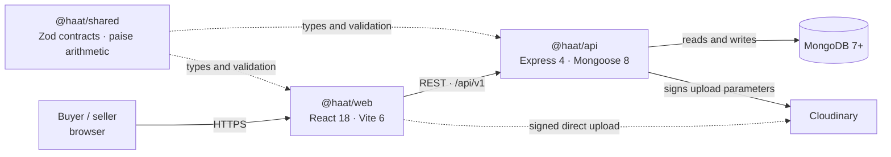

<p align="center">
  
</p>

<h1 align="center">HAAT</h1>

<p align="center">
  Retail and wholesale in one catalogue — quantity pricing, verified Indian stores,
  and scheduled delivery.
</p>

<p align="center">
  React · TypeScript · Express · MongoDB · Cloudinary
</p>

---

## Overview

Most Indian sellers quote one price for a single piece and another for a case. Most
marketplaces model only the first. HAAT models both on the same listing: a retail price
for buyers who need one item, and a quantity ladder that lowers the unit price as the
order grows. The buyer sees the tier that applies to the quantity in front of them.

| Order quantity | Unit price |
|---:|---:|
| 1–99 | ₹18.50 |
| 100–499 | ₹16.50 |
| 500+ | ₹15.00 |

One listing, three outcomes. The ladder is validated for gaps and overlaps when the seller
saves it, and a single shared function resolves the unit price for any quantity, so the
buyer's view and a future order total cannot disagree.

A listing carries variants (size, grade, finish), a minimum order quantity, an order
multiple, stock per variant, and up to twenty price tiers. Sellers publish from a console
with a live buyer preview. Buyers browse a public catalogue that excludes archived listings
and products from sellers whose verification is still pending; those products are saved but
withheld from public view until approval.

The system is a **modular monolith**, not a set of services. One Express application owns
the domain modules, one React application renders both buyer and seller surfaces, and a
shared package holds the contracts both sides compile against.

HAAT is delivered in three parts. Part 1 — foundation, authentication, seller onboarding
and the commerce core — is implemented. Parts 2 and 3 are scoped in the PRD and not yet
started.

## Status

| Part | Scope | State |
|---|---|---|
| **1 — Foundation & Commerce Core** | Monorepo, shared contracts, Express API, MongoDB models, auth with refresh rotation, seller onboarding and KYC record, category tree, product aggregate with variants, tiers and Cloudinary images, public catalogue and product pages, seller product console | **Code complete.** Typecheck, build and unit tests pass. Runtime acceptance against a live MongoDB is pending — see [`planning/Memory.md`](planning/Memory.md) §7. |
| **2 — Buyer Commerce & Scheduled Fulfilment** | Search facets, product detail, storefront, cart grouped by seller, checkout with atomic slot reservation, seller slot configuration, RFQ and quotation lifecycle | Not started |
| **3 — Real-Time, Payments, Admin & Hardening** | Socket.IO chat with a Redis adapter, order state machine, Razorpay and webhook settlement, invoices, super-admin consoles, audit trail, security and performance work | Not started |

Part 1 intentionally contains no cart, checkout, orders, slots, chat, RFQ, payments or
admin screens, and no disabled navigation placeholders for them.

## Architecture



Three design decisions shape the codebase:

**Money is an integer count of paise.** The database never stores rupees, and no
arithmetic is performed on floating-point currency. The web layer keeps rupee strings in
form state and converts once, at the boundary, with `rupeesToPaise`. Tiers, unit prices
and totals all flow through the same helpers in `@haat/shared`.

**Contracts are shared, not duplicated.** Request bodies, query strings, identifiers and
money rules are Zod schemas in `packages/shared`. The API validates every route with them;
the client reuses the same primitives for form validation, so a rule cannot drift between
the two sides.

**The product is one document.** Variants and pricing tiers are embedded in the product
aggregate, so a future stock decrement or price change is a single atomic document update
rather than a multi-collection transaction.


## Stack

| Layer | Choice | Notes |
|---|---|---|
| Runtime | Node.js 22 | ES modules throughout the API |
| Language | TypeScript 5.6 | `strict` mode, no `any` escape hatches in application code |
| Frontend | React 18, Vite 6, Tailwind 3.4 | React Router 6, TanStack Query 5, React Hook Form 7 |
| API | Express 4, Zod 3 | Middleware pipeline: request id, access log, rate limit, validation, errors |
| Data | MongoDB 7+, Mongoose 8 | Replica set for transactions; `sanitizeFilter` enabled globally |
| Media | Cloudinary | Server signs uploads; the browser uploads directly with the signature |
| Auth | JWT access token, opaque refresh token | 15-minute access token in memory; rotating refresh token in an HttpOnly cookie |
| Passwords | bcryptjs, cost 12 | Pure-JS implementation, chosen for portability |
| Tooling | pnpm 9.15 workspaces, esbuild, Vitest | API bundled to a single ESM file; Vitest for shared logic |

## Getting started

### Prerequisites

- Node.js 22 or newer
- pnpm 9.15 (`corepack enable pnpm`). If corepack is unavailable, `npx -y pnpm@9.15.0`
  can stand in for every command below.
- MongoDB 7 or newer. A replica set is required once transactional flows arrive in Part 2,
  and Atlas provides one by default.
- A Cloudinary account, optional for boot. Uploads return `503` until credentials are set.

### 1. Install

```bash
pnpm install
```

### 2. Configure

Copy `.env.example` to `.env` at the repository root. The API reads `apps/api/.env` first,
then the root `.env`.

| Variable | Purpose |
|---|---|
| `MONGODB_URI` | Connection string, including `?replicaSet=rs0` for a local replica set |
| `MONGODB_DB_NAME` | Database name (`haat`) |
| `JWT_ACCESS_SECRET` | At least 32 characters |
| `JWT_REFRESH_SECRET` | At least 32 characters, different from the access secret |
| `FRONTEND_URL` | Vite origin; CORS is credentialed and locked to this value |
| `CLOUDINARY_CLOUD_NAME`, `CLOUDINARY_API_KEY`, `CLOUDINARY_API_SECRET` | Signed uploads; optional at boot |
| `CLOUDINARY_UPLOAD_FOLDER` | Destination folder, for example `haat/dev` |

The web client defaults to `http://localhost:5000/api/v1`. To point it elsewhere, create
`apps/web/.env` containing `VITE_API_URL`; Vite reads its own project directory, not the
repository root.

Environment variables are validated by Zod at boot; the API exits with a readable error
rather than starting in a half-configured state.

### 3. Start MongoDB

```bash
mkdir -p /data/ha
mongod --replSet rs0 --dbpath /data/ha --port 27017
mongosh --eval "rs.initiate()"
```

On Windows, use a writable path such as `C:\data\haat`.

### 4. Seed demo data

```bash
pnpm seed
```

The seed is idempotent. It creates the category tree, an administrator, a verified seller
with six products, and the credentials below.

| Role | Identifier | Password |
|---|---|---|
| Super admin | `9000000001` | `Admin@12345` |
| Verified seller | `9876543210` | `Seller@12345` |

The seed seller's store slug is `menon-industrial`. Demo credentials are for local
development only.

### 5. Run

```bash
pnpm dev
```

This starts the API on `:5000` and the web client on `:5173`. If port 5173 is occupied,
Vite moves to the next free port and the credentialed CORS check will reject the page —
pin the port or update `FRONTEND_URL`.

| Command | Effect |
|---|---|
| `pnpm dev` | API and web together |
| `pnpm dev:api` / `pnpm dev:web` | One process at a time |
| `pnpm build` | Production bundles for API and web |
| `pnpm typecheck` | TypeScript across all workspace packages |
| `pnpm test` | Shared unit tests |
| `pnpm seed` | Idempotent demo data |

## API

Base path: `/api/v1`. Every response uses one envelope:

```json
{ "success": true, "data": {}, "error": null }
```

Failures carry a machine-readable `error.code` (`VALIDATION_ERROR`, `UNAUTHORIZED`,
`FORBIDDEN`, `NOT_FOUND`, `CONFLICT`, `DUPLICATE_KEY`, `RATE_LIMITED`, `INTERNAL_ERROR`)
and an optional `error.details[]` list of field-level issues.

### Authentication

| Method | Endpoint | Access | Purpose |
|---|---|---|---|
| POST | `/auth/register` | Public | Create a buyer account; returns a user and an access token |
| POST | `/auth/login` | Public | Sign in with a phone number or email |
| POST | `/auth/refresh` | Refresh cookie | Rotate the refresh token and issue a new access token |
| POST | `/auth/logout` | Refresh cookie | Revoke the presented token and clear the cookie |
| GET | `/auth/me` | Bearer | Current user and seller profile |

Refresh tokens are opaque, stored only as SHA-256 hashes, and rotated on every use.
Presenting an already-revoked token revokes every active session for that user.

### Sellers

| Method | Endpoint | Access | Purpose |
|---|---|---|---|
| GET | `/sellers/slug-available?slug=` | Public | Live store-link availability for onboarding |
| POST | `/sellers/onboarding` | Signed in | Create the store and upgrade the account role to seller |
| GET | `/sellers/me` | Seller | Owner-only store profile |

### Catalogue and media

| Method | Endpoint | Access | Purpose |
|---|---|---|---|
| GET | `/categories` | Public | Active category tree, cached for 60 seconds |
| POST | `/categories` | Admin | Create a category; writes an audit entry |
| GET | `/products` | Public | Approved, active products; `q`, `category`, `seller`, `sort`, `page`, `limit` |
| GET | `/products/:slug` | Public | Approved product by slug |
| GET | `/products/mine` | Seller | The caller's own catalogue, any status |
| GET | `/products/mine/:id` | Seller | One owned product, any status |
| POST | `/products` | Seller | Create a listing with variants and tiers |
| PATCH | `/products/:id` | Seller | Partial update, including re-listing an archived product |
| DELETE | `/products/:id` | Seller | Archive a listing; never a hard delete |
| POST | `/uploads/signature` | Seller | Signed Cloudinary upload parameters |

Object-level authorisation is enforced in the service layer: every seller mutation
re-resolves the seller profile and compares the stored `sellerId`. The identifier in the
URL is never trusted on its own.

## Design

The interface follows [`planning/Design.md`](planning/Design.md), which is normative rather
than inspirational. Navy `#1F319D` anchors the brand; marigold is reserved exclusively for
wholesale signals such as MOQ and tier pricing. Surfaces are separated by hairlines and
type scale, not by gradients, glass, or a shadow on every card. Money and quantities use
tabular numerals. Loading, empty, error and populated states exist on every data surface,
and a missing product image renders a hairline fallback with the SKU rather than a broken
icon.

Every new screen is reviewed against the written anti-pattern list in that document
before it is considered finished.

## Verification

| Check | Result |
|---|---|
| `pnpm typecheck` | Clean across `shared`, `api` and `web` |
| `pnpm test` | 30 of 30 shared tests pass — money, tier validation, product schema rules |
| `pnpm build` | API bundle 68.1 kB; web CSS 24.38 kB and JS 446.22 kB before gzip |

Two things have **not** been verified in the current environment: no request has been
executed against a running MongoDB, and no Cloudinary upload has been performed. Register,
login, onboarding, product lifecycle and the seed script are type-correct and
code-reviewed, but they still need one live pass. [`planning/Memory.md`](planning/Memory.md)
records this explicitly, together with the first actions for the next contributor.

## Roadmap

| Part | Delivers | Milestone |
|---|---|---|
| **1** | Foundation, auth, seller onboarding, catalogue, product console | Register → onboard → publish a product, end to end |
| **2** | Search facets, storefront, cart, checkout, slot reservation, RFQ | Search → cart → delivery slot → order draft, with concurrency tests |
| **3** | Chat, order state machine, Razorpay, invoices, admin, hardening | Paid order with a complete audit trail |

## Documentation

| Document | Contents |
|---|---|
| [`planning/PRD.md`](planning/PRD.md) | Canonical specification: domain model, API contracts, concurrency, security, delivery programme |
| [`planning/Design.md`](planning/Design.md) | Tokens, typography, motion, screen specifications, banned patterns, review gate |
| [`planning/Memory.md`](planning/Memory.md) | Build record: what exists, what was verified, known gaps, Part 2 kickoff |

## Working in this repository

- Specifications come before code. Product behaviour belongs in the PRD; visual decisions
  belong in the design document. New endpoints or tokens are added to the specification
  first.
- Money is stored in paise. Convert at the boundary and never store rupees.
- Validation lives at the edge. Every request body, query and parameter passes through a
  Zod schema from `@haat/shared`.
- Do not stub navigation for unbuilt parts. A screen either exists or the link does not.
- Code-owned MongoDB operators must be wrapped in `mongoose.trusted()` because
  `sanitizeFilter` is enabled globally.
