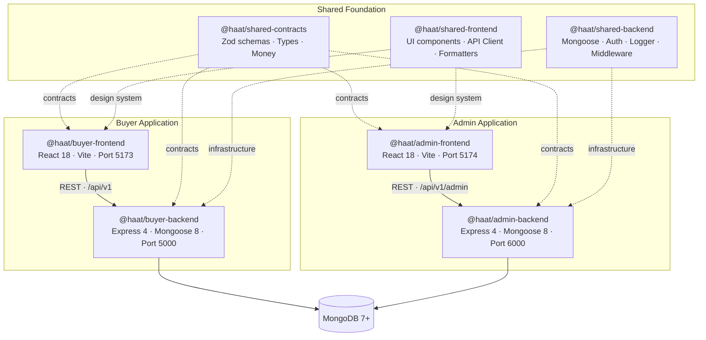

<p align="center">
  
</p>

<h1 align="center">HAAT</h1>

<p align="center">
  Retail and wholesale in one catalogue — quantity pricing, verified Indian stores,
  and scheduled delivery.
</p>

<p align="center">
  React · TypeScript · Express · MongoDB · Cloudinary
</p>

---

## Overview

Most Indian sellers quote one price for a single piece and another for a case. Most
marketplaces model only the first. HAAT models both on the same listing: a retail price
for buyers who need one item, and a quantity ladder that lowers the unit price as the
order grows. The buyer sees the tier that applies to the quantity in front of them.

| Order quantity | Unit price |
| -------------: | ---------: |
|           1–99 |     ₹18.50 |
|        100–499 |     ₹16.50 |
|           500+ |     ₹15.00 |

One listing, three outcomes. The ladder is validated for gaps and overlaps when the seller
saves it, and a single shared function resolves the unit price for any quantity, so the
buyer's view and a future order total cannot disagree.

A listing carries variants (size, grade, finish), a minimum order quantity, an order
multiple, stock per variant, and up to twenty price tiers. Sellers publish from a console
with a live buyer preview. Buyers browse a public catalogue that excludes archived listings
and products from sellers whose verification is still pending; those products are saved but
withheld from public view until approval.

The system is organized into two primary applications with a shared foundation:

- **Buyer Application**: Buyer-facing marketplace and seller console (onboarding, catalog management).
- **Admin Application**: Independent governance dashboard, seller verification, taxonomy management, and audit logs.
- **Shared Packages**: Contracts (Zod schemas, types), Backend infrastructure, and Frontend design system primitives.

HAAT is delivered in three parts according to `planning/PRD.md`. Part 1 — foundation, authentication, seller onboarding,
and the commerce core — is implemented. Parts 2 and 3 are scoped in the PRD and not yet started.

## Delivery Status

| Part                                           | Scope                                                                                                                                                                                                                                                                                                                  | State                                                                                                                                                              |
| ---------------------------------------------- | ---------------------------------------------------------------------------------------------------------------------------------------------------------------------------------------------------------------------------------------------------------------------------------------------------------------------- | ------------------------------------------------------------------------------------------------------------------------------------------------------------------ |
| **1 — Foundation & Commerce Core**             | Monorepo, shared contracts, Express APIs, MongoDB models, auth with refresh rotation, seller onboarding and business registration record, category tree, product aggregate with variants, tiers and Cloudinary images, public catalogue and product pages, seller product console, admin dashboard and seller approval | **Code complete.** Typecheck, build and unit tests pass. Runtime acceptance against a live MongoDB is pending — see [`planning/Memory.md`](planning/Memory.md) §7. |
| **2 — Buyer Commerce & Scheduled Fulfilment**  | Search facets, product detail, storefront, cart grouped by seller, checkout with atomic slot reservation, seller slot configuration, RFQ and quotation lifecycle                                                                                                                                                       | Not started                                                                                                                                                        |
| **3 — Real-Time, Payments, Admin & Hardening** | Socket.IO real-time communication, order state machine, Razorpay and webhook settlement, invoices, super-admin consoles, audit trail, security and performance work                                                                                                                                                    | Not started                                                                                                                                                        |

## Architecture



### Core Architectural Decisions

- **Two Independent Applications**: Buyer and Admin have separate frontends, backends, entry points, layouts, and routing.
- **Money is an integer count of paise**: The database never stores rupees, avoiding floating-point drift. Forms convert once at the boundary with `rupeesToPaise`.
- **Contracts are shared, not duplicated**: Schemas for validation, DTOs, and error codes live in `@haat/shared-contracts` and are reused by both server and browser.
- **The product is one document**: Variants and tiers are embedded in the aggregate for atomic updates.
- **Seller role resides in Buyer**: For the current stage, Seller functionality is logically grouped within the Buyer application and will be split into an independent top-level module in a future phase.

## Tech Stack

| Layer           | Choice                                            | Notes                                                          |
| --------------- | ------------------------------------------------- | -------------------------------------------------------------- |
| Runtime         | Node.js 22 LTS                                    | ES modules throughout                                          |
| Language        | TypeScript 5.6                                    | `strict` mode throughout all packages                          |
| Frontend        | React 18, Vite 6, Tailwind 3.4                    | React Router 6, TanStack Query 5, React Hook Form 7, Zod       |
| Backend         | Express 4, Mongoose 8                             | Modular MVC: Controllers, Services, Models, Routes, Validators |
| Database        | MongoDB 7+                                        | Mongoose 8; replica set for future transactions                |
| Auth            | JWT access token (15m), opaque refresh token (7d) | Refresh rotation with reuse detection; HttpOnly cookie         |
| Package Manager | pnpm 9.15 workspaces                              | Strict workspace boundary enforcement                          |

## Getting Started

### Prerequisites

- Node.js 22+
- pnpm 9.15+ (`npm install -g pnpm@9.15.0` or `corepack enable pnpm`)
- MongoDB 7+ (local replica set or MongoDB Atlas)

### 1. Install Dependencies

```bash
pnpm install
```

### 2. Configure Environment

Copy `.env.example` to `.env` at the repository root:

```bash
cp .env.example .env
```

### 3. Run Applications Independently

#### Run Buyer Application (Port 5173 / Port 5000)

```bash
# Run both Buyer frontend and backend
pnpm dev:buyer

# Or run individually:
pnpm dev:buyer:frontend
pnpm dev:buyer:backend
```

#### Run Admin Application (Port 5000 / Port 6000)

```bash
# Run both Admin frontend and backend
pnpm dev:admin

# Or run individually:
pnpm dev:admin:frontend
pnpm dev:admin:backend
```

#### Run All Services Together

```bash
pnpm dev
```

### 4. Build, Typecheck & Test

```bash
# Typecheck all packages
pnpm typecheck

# Run tests
pnpm test

# Build all packages
pnpm build
```
