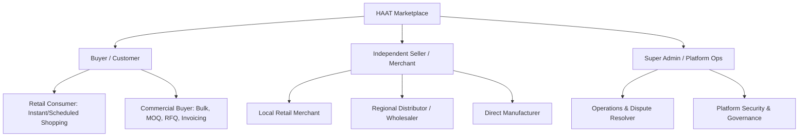
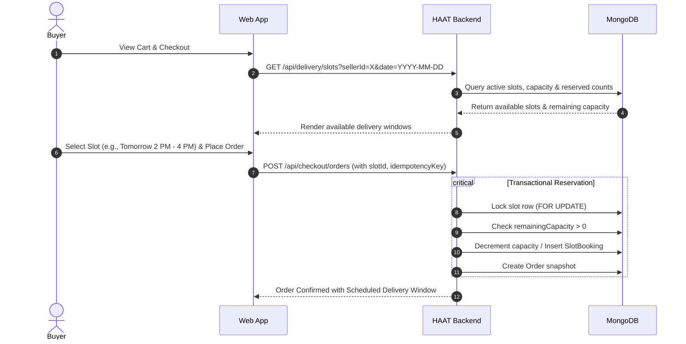
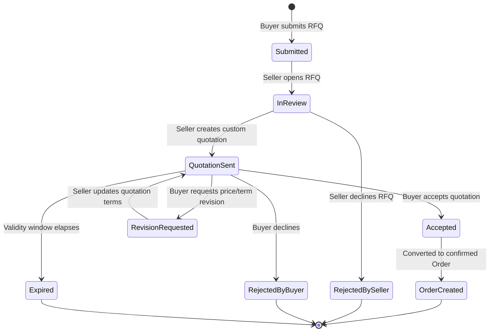
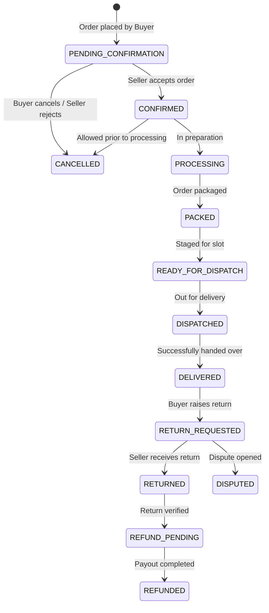
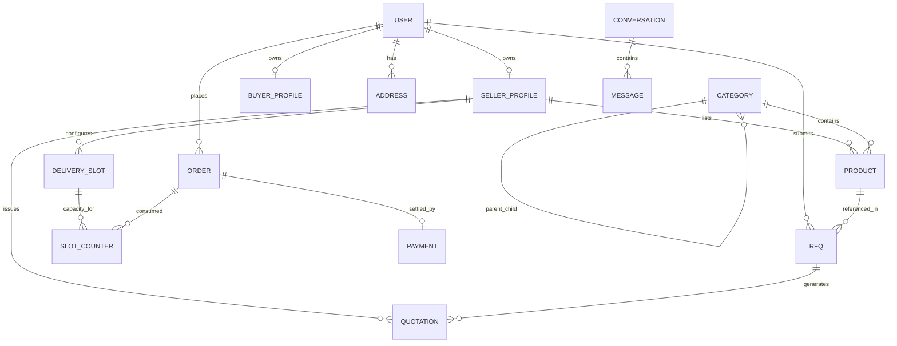
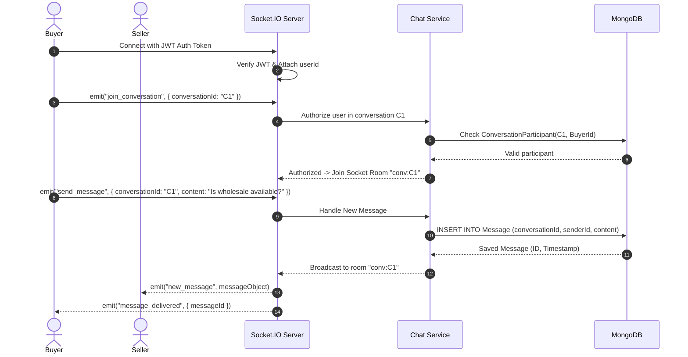
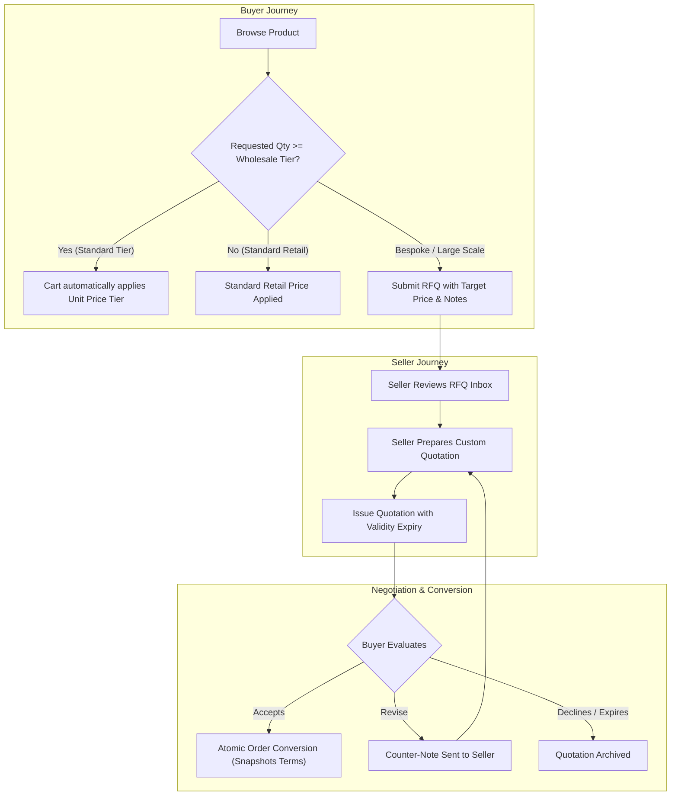
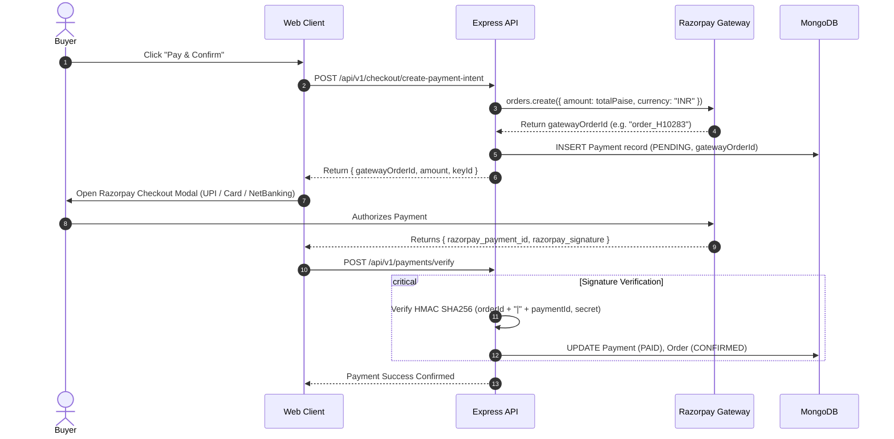

# HAAT — Product Requirements Document (PRD)

---

## 1. Document Control & Overview

| Document Attribute | Details |
|---|---|
| **Project Name** | **HAAT** |
| **Tagline / Positioning** | India's Retail & Wholesale Marketplace |
| **Document Version** | 2.2.0 (MongoDB + Cloudinary amendment) |
| **Status** | Approved Baseline — sole source of truth |
| **Database** | **MongoDB (Atlas or self-hosted) via Mongoose 8** — replaces PostgreSQL/Prisma |
| **Media Storage** | **Cloudinary** (signed direct uploads + CDN delivery) |
| **Amendment A-1** | v2.2.0 supersedes every PostgreSQL / Prisma reference in this document. The canonical mapping lives in **§14.5**; the rules are restated in **§15.5**. No other data store is permitted. |
| **Consolidated Sources** | `README.md`, `planning/Architecture.md`, `planning/Rules.md`, `planning/Task.md` — **merged and archived** into **Part II (Sections 13–18)** |
| **Companion Document** | `planning/Design.md` — UI/UX, brand system, motion specification and apple-design audit (see Section 13.2) |
| **Pending Document** | `planning/Memory.md` — session continuity ledger; create at the first completed task (see Section 17.1) |
| **Structure** | **Part I** = canonical Product Requirements (Sections 1–12). **Part II** = consolidated summaries + consistency register + definition of done (Sections 13–18). |
| **Target Platforms** | Responsive Web (Mobile-First Buyer, Desktop-Optimized Seller & Admin) |
| **Primary Audience** | Product Managers, Software Architects, Engineering Leads, AI Agents |

> **Archival Notice (v2.1.0).**
> After full consolidation, the source files `README.md`, `planning/Task.md`, `planning/Rules.md` and `planning/Architecture.md` were **deleted from the repository**. `planning/PRD.md` is now the single authoritative project document.
> Any reference in the text below to those four paths resolves as follows:
>
> | Deleted path | Now lives in |
> |---|---|
> | `README.md` | Section 13 |
> | `planning/Architecture.md` | Section 14 |
> | `planning/Rules.md` | Section 15 |
> | `planning/Task.md` | Section 16 |
>
> The engineering standards formerly in `Rules.md` remain **binding** (Section 15). The task IDs and acceptance criteria formerly in `Task.md` remain **binding** (Section 16).

---

## 2. Executive Summary & Vision

### 2.1 Vision
**HAAT** is a next-generation multi-vendor digital commerce marketplace crafted specifically for the Indian commerce ecosystem. It bridges the historical chasm between convenient retail consumer purchasing (a fast, intuitive Blinkit-style discovery and checkout experience) and large-scale B2B commercial purchasing (an Alibaba-style wholesale, minimum order quantity, tiered pricing, and quotation workflow). 

Unlike quick-commerce platforms that force centralized dark stores and arbitrary 10-minute delivery promises, HAAT empowers local and regional independent sellers, wholesalers, distributors, and manufacturers with digital storefronts and customer-driven **scheduled delivery windows**. Buyers can select the exact calendar day and time slot convenient for receiving their goods.

### 2.2 Core Product Principles
1. **Direct Buyer-Seller Connection:** The platform provides high-trust infrastructure (messaging, catalogue, negotiations, payments, slot scheduling) without inserting manual human intermediaries or brokerages into transactions.
2. **Retail and Wholesale Co-existence:** A single product catalogue entry can cater simultaneously to a consumer buying 1 unit at retail price and a commercial enterprise buying 500 units at bulk-tiered pricing or negotiated quotation.
3. **Scheduled Delivery First:** Predictable, transparent fulfilment scheduled by customer preference within seller-configured operating capacities, rather than unsustainable instant delivery promises.
4. **Seller Autonomy & Brand Ownership:** Sellers manage their own storefronts, product catalogues, variant matrices, tier-based pricing rules, inventory thresholds, service radiuses, and delivery slot capacities.
5. **Transparent Order Ownership:** Multi-seller carts decompose into distinct, seller-specific order fulfilment groups with independent status lifecycles, delivery slots, and invoices.
6. **Trust, Verification & Accountability:** Comprehensive seller verification, immutable order and quotation snapshots, transparent dispute mechanisms, and auditable status histories.
7. **Mobile-First Accessibility:** Lightning-fast, thumb-friendly navigation for buyers on diverse mobile devices, paired with dense, data-efficient management interfaces for sellers and administrators on desktop.

---

## 3. Market Opportunity & Problem Statement

### 3.1 The Problem
In the Indian commerce landscape, buyers and sellers are fragmented across disjointed channels:
- **Retail Consumers** face rigid quick-commerce platforms restricted to dark-store groceries with high markups and no direct seller relationships.
- **B2B Bulk Buyers (Small Retailers, Offices, Contractors)** are forced into offline wholesale markets, unrecorded phone negotiations, physical visits, and opaque logistics tracking without payment guarantees.
- **Independent Sellers & Wholesalers** lack a unified digital platform where they can showcase both single-unit retail items and wholesale lots, manage custom quotations, converse directly with high-intent buyers, and control their own delivery schedule.

### 3.2 The Solution
HAAT provides a unified marketplace platform where:
- A buyer can order household goods or consumer electronics for delivery tomorrow between 2:00 PM – 4:00 PM.
- A business owner can order 100 units of the same item at tiered wholesale pricing, or request a custom quotation (RFQ) for 1,000 units with specialized delivery terms.
- Direct real-time chat with the seller clarifies product specifications, availability, or quotation terms instantly.

### 3.3 Supported Catalogue Sectors
HAAT is **not a grocery-only app**. It is an open, multi-category commercial marketplace supporting:
- Electronics & Accessories
- Fashion, Apparel & Footwear
- Groceries, Staples & Packaged Food Products
- Home, Living & Kitchen Essentials
- Hardware, Electricals & Industrial Supplies
- Office Supplies, Stationery & Packaging Materials
- Furniture & Commercial Fixtures
- Personal Care, Beauty & Wellness
- General Merchandise & Seasonal Goods
- *Extensible architecture for future commercial categories.*

---

## 4. User Personas & Target Audience



### 4.1 Buyer Personas
1. **The Individual Consumer (B2C):**
   - **Profile:** Households, students, working professionals seeking quality products with reliable, scheduled delivery windows.
   - **Needs:** Clean product discovery, transparent pricing, verified sellers, flexible delivery slots (e.g., evening after work), easy UPI/card checkout, live order tracking.
2. **The Commercial / Bulk Buyer (B2B):**
   - **Profile:** Small business owners, kirana stores, corporate procurement officers, contractors, and event organizers.
   - **Needs:** Tiered wholesale discounts, Minimum Order Quantity (MOQ) clarity, formal Request for Quotation (RFQ) tools, GST-compliant invoicing, direct negotiation via chat, scheduled high-volume delivery.

### 4.2 Seller Personas
1. **The Retail Merchant:**
   - **Profile:** Local shops, branded outlets, and specialty retailers seeking broader local/regional market reach.
   - **Needs:** Fast catalogue listing, variant management, inventory control, automated delivery slot capacity limits, seamless order fulfilment.
2. **The Wholesaler & Distributor:**
   - **Profile:** Stockists and wholesale distributors dealing in carton/pallet quantities.
   - **Needs:** Quantity price breaks, MOQ configuration, RFQ inbox, custom quotation builder with validity windows, bulk delivery coordination.
3. **The Direct Manufacturer:**
   - **Profile:** Regional producers seeking direct-to-retailer and direct-to-consumer distribution without middlemen.

### 4.3 Administrator Persona (Read-Only Marketplace Monitoring)
1. **Marketplace Monitoring & Analytics Administrator:**
   - **Role:** Strictly read-only monitoring, analytics, and surveillance.
   - **Capabilities:** Admin can view buyer accounts, seller directory and business performance, individual seller analytics, orders, payment transactions, and platform-wide metrics.
   - **Strict Constraints:** Admin cannot create, edit, or delete buyers or sellers; cannot approve or reject seller applications; cannot block or unblock sellers; cannot manage products or inventory; cannot modify prices or stock; cannot manage orders or deliveries; cannot modify transactions or initiate refunds. All write operations are rejected at the API middleware boundary with HTTP 403 `FORBIDDEN_READ_ONLY_ADMIN`.
   - **Separation of Metrics:** Distinguishes Gross Merchandise Value (GMV), completed paid order value, and platform commission. Marketplace GMV is never conflated with platform revenue or profit.

---

## 5. Detailed Product Features & Functional Requirements

### 5.1 Multi-Vendor Storefront & Catalogue Discovery
- **Storefronts:** Every verified seller has an independent storefront URL (`/store/:sellerSlug`) displaying their company branding, verification badge, rating, operational hours, delivery capabilities, and product categories.
- **Product Hierarchy:** Root Categories -> Sub-Categories -> Products -> Variants (Attributes: Color, Size, Material, Pack Size, Voltage, etc.).
- **Dynamic Pricing Display:**
  - Standard Retail Unit Price (for purchase quantities below wholesale tiers).
  - Bulk Pricing Table: Visible tier breakdown (e.g., 1–9 units @ ₹500, 10–49 @ ₹450, 50–99 @ ₹400, 100+ @ ₹350).
  - Minimum Order Quantity (MOQ) indicator and order multiple requirements (e.g., sold in multiples of 5).
- **Search & Filtering:**
  - Multi-attribute full-text search across product title, SKU, tags, category, and seller name.
  - Faceted filters: Price range, Category, Seller, Rating, In-Stock only, Wholesale Available, Delivery Slot availability.
- **Product Detail Page (PDP):**
  - High-resolution image gallery with zoom and variant switching.
  - Comprehensive specifications table, warranty, and return policy details.
  - Seller information card with "Chat with Seller" and "Visit Store" actions.
  - Dual action buttons: "Add to Cart" (Retail/Bulk tier) and "Request Quotation (RFQ)".

### 5.2 Scheduled Delivery & Slot Capacity Management
Scheduled delivery is a foundational differentiator for HAAT. Delivery is planned for a selected date and time slot rather than arbitrary instant rush.



- **Seller Slot Configuration:**
  - Define operating days (e.g., Monday–Saturday) and blackout/holiday dates.
  - Define custom time slots (e.g., 09:00 AM – 12:00 PM, 02:00 PM – 05:00 PM, 06:00 PM – 09:00 PM).
  - Configure maximum order capacity per slot (e.g., 15 deliveries per slot).
  - Configure lead time (e.g., minimum 4 hours preparation buffer before first available slot).
  - Configure daily cut-off times (e.g., orders for tomorrow morning must be placed by 8:00 PM today).
  - Define delivery service areas (Pincodes / Geo-radiuses).
- **Buyer Scheduling Experience:**
  - Interactive calendar picker showing available dates (up to 7 days in advance).
  - Real-time time slot selector indicating availability ("Available", "Filling Fast", "Sold Out").
  - Clear presentation of delivery schedule in order confirmations and tracking views.
- **Rescheduling Rules:** Buyers may request slot rescheduling only prior to seller dispatch, subject to seller approval and target slot capacity.

### 5.3 Bulk Ordering, MOQ & Quantity-Based Pricing
- **Tier Configuration:** Sellers define arbitrary, non-overlapping tiered quantity ranges `[minQty, maxQty]` with associated unit prices.
- **Cart Tier Auto-Detection:** As the buyer adjusts product quantity in the cart, the unit price automatically recalculates based on the qualified tier.
- **MOQ Enforcement:** Server-side validation strictly rejects cart checkout if any item’s quantity is below its designated MOQ.
- **Order Multiples:** Enforces packaging constraints (e.g., master carton sizing requiring purchases in multiples of 10 or 25).

### 5.4 Request for Quotation (RFQ) & Custom Quotation Workflow
For bespoke enterprise needs, large-scale wholesale orders, or volume beyond standard tiers, HAAT provides an asynchronous RFQ negotiation engine.



- **Buyer RFQ Submission:**
  - Specify requested quantity, target price per unit, expected delivery location/date, and technical/customization notes.
  - Automatically captures product and variant snapshot.
- **Seller Quotation Builder:**
  - Seller sets negotiated unit price, minimum purchase commitment, delivery charges, packaging terms, payment conditions, and quotation expiration timestamp.
- **Quotation Acceptance & Conversion:**
  - Upon buyer acceptance prior to expiration, the quotation atomically converts into a valid checkout order, locking in the agreed quotation terms and snapshot.

### 5.5 Direct Buyer-Seller Real-Time Chat
HAAT features built-in contextual real-time messaging powered by Socket.IO.
- **Contextual Initiation:**
  - Start chat directly from a Product Detail Page (attaches product card preview).
  - Start chat from an active Order (attaches order number, delivery date, status).
  - Start chat from an RFQ / Quotation (attaches quote details).
- **Capabilities:**
  - Instant one-to-one messaging between authenticated buyer and seller accounts.
  - Image and specification document attachments (PDF/images with strict virus/MIME validation).
  - Real-time online/offline presence indicators.
  - Delivered and Read status receipts (ticks).
  - Real-time unread counter badges across header and conversation list.
- **Security & Privacy:**
  - Strict membership isolation: Only participating buyer and verified seller staff can enter a room or query historical messages.
  - All messages are validated and persisted to MongoDB before Socket.IO broadcasts to rooms.
  - Rate limiting on message sending to prevent spam or DoS.
  - Conversation reporting tool for buyers/sellers to flag abusive behavior to platform admins.

### 5.6 Shopping Cart & Multi-Seller Checkout
- **Unified Cart with Seller Grouping:**
  - Buyers can add products from multiple independent sellers into a single cart.
  - The cart visually decomposes items into distinct **Seller Fulfilment Groups**.
- **Per-Seller Delivery Selection:**
  - Since each seller operates their own logistics and slot schedule, the buyer selects a delivery slot per fulfilment group.
- **Server-Side Price & Stock Revalidation:**
  - When proceeding to checkout, client prices and availability are ignored. The backend locks items, re-verifies active prices, bulk tier eligibility, stock levels, and slot availability.
- **Idempotent Order Creation:**
  - Checkouts require client-generated idempotency keys (`idempotency_key: UUID`) to prevent duplicate transactions on network reconnects or double button clicks.
- **Financial Breakdown:**
  - Detailed transparent calculation: Item subtotal, Applicable GST/Taxes, Delivery charges per seller, Discounts/Coupons, and Final total.

### 5.7 Order Lifecycle & State Machine
Orders must transition strictly through an auditable, verified state machine:



- **Order Snapshots:**
  - Every order item preserves an immutable snapshot of product title, SKU, variant attributes, unit price at time of purchase, tax rate, and seller business details. Changes to future catalogue prices never alter historical orders.
- **Tracking & Audit Log:**
  - Each state change records: previous state, new state, actor ID, actor role, timestamp, and optional remarks.

### 5.8 Payment Architecture & Settlement Requirements
- **Supported Payment Modes (Modular):**
  - UPI (Instant intent & QR).
  - Net Banking.
  - Credit / Debit Cards.
  - Cash on Delivery (COD) — *Subject to seller approval & platform toggle*.
- **Payment Provider:** Integrated via modular abstraction with Razorpay as the initial implementation.
- **Verification Integrity:** Payments are never marked as completed based solely on client-side browser redirects. The backend verifies cryptographic webhook signatures and performs server-to-server payment status confirmation.

### 5.9 Seller Management & Store Operations
- **Onboarding & Store Registration:** Business registration details, GSTIN, bank account information, store branding, and coverage area details.
- **Inventory Management:** Low-stock threshold alerts, batch stock updates, reserve-against-order tracking.
- **Fulfilment Center:** Centralized order inbox with filter tabs (New, In Progress, Scheduled Today, Completed).
- **Delivery Configuration:** Slot capacity limits, cut-off hours, holiday calendar, delivery radius/pincode whitelist.
- **Business Analytics:** Sales volume, gross merchandise value (GMV), top-performing products, customer ratings, cancellation ratios.

### 5.10 Super Admin Governance & Platform Operations
- **Seller Verification:** Review submitted business documents, approve/reject seller applications with audit notes.
- **Product Listing Moderation:** Review newly created products, flag inappropriate or counterfeit listings, suspend non-compliant SKUs.
- **Platform Order & Financial Oversight:** View all marketplace transactions, filter by status, inspect dispute threads, monitor payment reconciliations.
- **Dispute Resolution Console:** Review buyer-seller conversation logs, order history, delivery proofs, and issue authoritative refund/return decisions.
- **System Audit Logs:** Immutable logs capturing high-impact administrative actions (seller approvals, category deletions, fee changes, manual cancellations).

---

## 6. Functional Requirements Matrix (FRs)

| Req ID | Module | Description | Criticality |
|---|---|---|---|
| **FR-01** | Auth | User registration and authentication via JWT with role assignment (Buyer, Seller, Admin) | Critical |
| **FR-02** | Catalogue | Multi-level category hierarchy and multi-variant product management | Critical |
| **FR-03** | Catalogue | Seller-defined retail unit price, MOQ, and quantity-based pricing tier matrix | Critical |
| **FR-04** | Delivery | Seller-configurable operating days, time slots, order capacity, and cut-off buffers | Critical |
| **FR-05** | Delivery | Transactional delivery slot capacity reservation during checkout to prevent overbooking | Critical |
| **FR-06** | Cart | Seller-grouped cart decomposition with live bulk-tier price adjustment | Critical |
| **FR-07** | Checkout | Idempotent multi-seller checkout with server-side stock and slot revalidation | Critical |
| **FR-08** | RFQ | Asynchronous RFQ submission, custom quotation generation, revision, and order conversion | High |
| **FR-09** | Chat | Real-time Socket.IO buyer-seller messaging with context binding and persistence | High |
| **FR-10** | Orders | Strict order status state machine enforcement with immutable audit logging | Critical |
| **FR-11** | Orders | Historical order snapshot preservation for items, prices, taxes, and addresses | Critical |
| **FR-12** | Payments | Modular payment processing with Razorpay, webhook verification, and refund state tracking | High |
| **FR-13** | Admin | Seller application approval, catalogue moderation, dispute management, and audit inspection | High |
| **FR-14** | Reviews | Verified-purchase rating and review submission for products and seller stores | Medium |
| **FR-15** | Notifications | In-app notifications and event dispatchers for order updates, chat, and quotes | Medium |

---

## 7. Non-Functional Requirements (NFRs)

### 7.1 Performance & Response Times
- **Catalog Browsing & Search:** Median API response time $\le 100\text{ ms}$; 95th percentile $\le 250\text{ ms}$ under standard indexing.
- **Cart & Checkout Initiation:** 95th percentile $\le 300\text{ ms}$ excluding external payment gateway roundtrips.
- **Real-Time Chat Latency:** In-room message delivery $\le 150\text{ ms}$ via Socket.IO.
- **Page Load Speed:** First Contentful Paint (FCP) $\le 1.2\text{ s}$, Largest Contentful Paint (LCP) $\le 2.0\text{ s}$ on 4G connections.

### 7.2 Concurrency & Data Integrity
- Zero overselling: High-concurrency checkout must not oversell product inventory or delivery slot capacity. Database-level locking (`SELECT FOR UPDATE`) or serializable isolation guarantees inventory consistency.
- Financial Precision: Zero floating-point arithmetic. All monetary values are represented as positive 64-bit integers in minor units (paise) with explicit ISO currency (`INR`).

### 7.3 Availability & Fault Tolerance
- System target availability: 99.9% uptime during operational commercial hours.
- Graceful degradation: Payment webhook retries, asynchronous notification dispatch, and circuit-breaking on third-party dependencies (Cloudinary, Razorpay).

### 7.4 Observability & Auditability
- Structured JSON logging across all backend requests with contextual `correlationId`, `userId`, `route`, and duration.
- Secrets, tokens, credit card details, and PII are redacted from application logs.

---

## 8. Security & Compliance Requirements

1. **Authentication & Session Security:**
   - Password hashing utilizing Argon2id or bcrypt (cost factor $\ge 12$).
   - Short-lived JSON Web Tokens (access token $\le 15$ minutes) coupled with secure, `HttpOnly`, `SameSite=Strict` refresh tokens with rotation and revocation.
2. **Authorization & Access Control:**
   - Strict Role-Based Access Control (RBAC): `BUYER`, `SELLER`, `ADMIN`, `SUPER_ADMIN`.
   - Resource-Level / Object-Level Authorization: Every request querying or mutating a resource (order, message, quotation, product) verifies that the authenticated user owns or is authorized to access that specific entity ID (prevention of Insecure Direct Object References - IDOR).
3. **Data Protection & Sanitization:**
   - All inbound payloads validated against strict Zod schemas on both frontend and backend.
   - Comprehensive protection against injection: Zod-validated inputs, `sanitizeFilter` enabled, and no request body ever spread directly into a Mongo query.
   - Cross-Site Scripting (XSS) prevention through HTML sanitization of text inputs.
4. **Network & Transport Security:**
   - Enforce TLS 1.3 across all communication.
   - Strict Content Security Policy (CSP), CORS whitelist restricted to trusted application origins.
   - Rate limiting on public endpoints: Authentication attempts ($\le 5\text{ requests/min}$ per IP), RFQ creation ($\le 10/\text{hour}$), Chat room initialization ($\le 30/\text{min}$).

---

## 9. Accessibility & Internationalization Requirements

- **Accessibility:** Compliance with WCAG 2.1 Level AA standards. All buttons and interactive controls provide proper ARIA attributes, semantic HTML structure, keyboard navigation, and minimum $44 \times 44\text{ px}$ mobile touch targets.
- **Display Localization:** Currency rendered in Indian numbering format (e.g., ₹1,50,000.00). Dates and scheduled slots rendered in Indian Standard Time (IST, UTC+05:30).

---

## 10. Scope Boundaries

### 10.1 MVP Scope (Phase 1–10)
- Core Buyer, Seller, and Admin authentication with RBAC.
- Multi-vendor catalogue with variants, images, categories, and search/filtering.
- Dual retail and bulk pricing tiers with MOQ enforcement.
- Scheduled delivery slot configuration, capacity tracking, and checkout slot reservation.
- Multi-seller shopping cart with split fulfilment groups.
- RFQ creation, seller quotation response, acceptance, and order conversion.
- Direct 1-on-1 buyer-seller Socket.IO chat with message history and unread tracking.
- Order lifecycle state machine, historical snapshots, and invoice records.
- Modular Razorpay payment integration and webhook verification.
- Admin dashboard for seller verification, catalogue moderation, and dispute inspection.

### 10.2 Future Enhancements (Post-MVP)
- Mobile Native Apps (React Native / Flutter).
- Seller staff multi-user permissions with granular role delegation.
- Automated delivery route optimization and driver dispatch app.
- Multi-lingual UI support (Hindi, Tamil, Telugu, Bengali, Marathi, Gujarati).
- Escrow-based milestone payments for high-value industrial RFQ orders.
- Advanced AI-assisted semantic search and catalogue attribute extraction.

### 10.3 Explicit Non-Goals for Initial Release
- **No Instant / 10-Minute Delivery:** HAAT will not support or advertise instant quick-commerce delivery. Fulfilment is scheduled.
- **No Platform-Owned Delivery Fleet:** HAAT does not operate dark stores or platform delivery vehicles; delivery logistics are managed by individual sellers or their contracted couriers.
- **No AI-Generated Catalogue or Fake Reviews:** No automated synthetic product creation or AI recommendation loops in v1.
- **No International Cross-Border Customs/Tax:** V1 is strictly focused on domestic Indian commerce (INR / GST).
- **No Microservices or Premature Distributed Infrastructure:** The system is explicitly architected as a clean modular monolith.

---

## 11. Unresolved Product Decisions (OPEN / UNDECIDED)

The following business and operational policies are currently open and require formal leadership determination during development:

| Decision ID | Domain | Open Question | Current Architecture Stance / Fallback |
|---|---|---|---|
| **DEC-01** | **Payment Collection** | Does HAAT operate as a Merchant of Record (central collection with seller payout settlements) or allow direct seller collection? | Platform uses modular payment service. Architecture supports central escrow with seller ledger tracking. |
| **DEC-02** | **Cash on Delivery (COD)** | Should COD be globally enabled, seller-opt-in, or restricted based on buyer order value? | Model as a seller-configurable toggle per product and order value threshold. |
| **DEC-03** | **Commission Model** | How are platform commissions structured (percentage per category, fixed transaction fee, or subscription tier)? | System records raw totals and maintains modular commission calculation hook in payment service. |
| **DEC-04** | **Logistics Ownership** | Will HAAT integrate a 3rd-party logistics aggregator (e.g., Shiprocket, Delhivery) or rely 100% on seller self-delivery? | Architecture models delivery as seller-fulfilled with extensible courier tracking fields. |
| **DEC-05** | **Business Buyer Verification** | Does a B2B buyer require formal GSTIN/business verification before accessing wholesale tiers or submitting RFQs? | Unverified buyers can view wholesale tiers and submit RFQs; GSTIN verification is optional for tax invoice credits. |
| **DEC-06** | **Dispute & Refund Liability** | What are the exact liability windows and financial debit policies when a dispute is ruled against a seller? | State machine supports `DISPUTED` and `REFUND_PENDING`; administrative override enables manual resolution. |

---

## 12. Verification & Acceptance Criteria

A feature in the PRD is accepted when:
1. All corresponding functional and non-functional requirements pass automated tests (unit, integration, and security checks).
2. The UI renders loading, empty, error, and populated states correctly across mobile and desktop breakpoints.
3. Database transactions prevent race conditions during concurrent checkouts and slot reservations.
4. Role-based and object-level authorization tests verify that unauthorized users cannot view or manipulate resources.
5. All code adheres strictly to the rules documented in `planning/Rules.md`.

---
---

# PART II — CONSOLIDATED SUMMARIES OF ALL PROJECT DOCUMENTS

> **Consolidation Note**
> Part I (Sections 1–12) is the authoritative Product Requirements Document. Part II folds every other Markdown artefact in the repository into this single file so that a human engineer or an AI agent can work from `PRD.md` alone, without losing the intent of the original documents.
>
> | Source document | Consolidated into |
> |---|---|
> | `README.md` | Section 13 — Project Overview & Documentation System |
> | `planning/Architecture.md` | Section 14 — Technical Architecture Summary |
> | `planning/Rules.md` | Section 15 — Engineering Standards & AI Agent Rules |
> | `planning/Task.md` | Section 16 — Development Roadmap & Master Task Backlog |
> | Cross-document review | Section 17 — Consistency, Gaps & Open Decisions Register |
> | All documents | Section 18 — Unified Definition of Done |

---

## 13. Project Overview & Documentation System (from `README.md`)

### 13.1 Positioning Statement
**HAAT — India's Retail & Wholesale Marketplace.** A modern Indian multi-vendor commerce platform that combines:

- A **fast, Blinkit-style consumer retail** shopping experience (rapid discovery, clean PDP, cart, checkout).
- An **Alibaba-style B2B wholesale engine** (bulk pricing tiers, MOQ enforcement, order multiples, custom Request for Quotation workflows, direct buyer–seller negotiation, scheduled delivery slots).

### 13.2 Central Project Documentation System
All requirements, architecture specifications, development rules, design systems, and execution roadmaps are consolidated in the `planning/` directory. These documents constitute the **single source of truth** for human engineers and AI coding agents:

| Document | Status | Purpose & Scope |
|---|---|---|
| `planning/PRD.md` | **Canonical** | Product Requirements Document — vision, personas, functional & non-functional requirements, scheduled delivery model, bulk pricing tiers, RFQ workflows, order lifecycle, security, open business decisions. Contains the consolidated copies of every other document (Part II). |
| `planning/Design.md` | **Canonical** | UI/UX, brand system, motion specification, component inventory, screen-by-screen design and the `apple-design` audit. Authored after consolidation — see Section 17.1. |
| `planning/Memory.md` | **Pending** | Session continuity ledger — decisions, implementation state and next task. Must be created at the first completed task. |
| ~~`planning/Architecture.md`~~ | Archived → §14 | Technical Architecture & Data Specifications: modular monolith, MongoDB collections, atomic slot reservation, Socket.IO real-time communication, Razorpay flow. |
| ~~`planning/Rules.md`~~ | Archived → §15 | Engineering Standards & AI Agent Rules: pnpm, strict TypeScript, thin controllers, paise integers, object-level authorization, no Docker/microservices. **Still binding.** |
| ~~`planning/Task.md`~~ | Archived → §16 | Development Roadmap & Master Task Tracker, Phase 1 → Phase 10, task IDs, acceptance criteria, dependencies. **Still binding.** |
| ~~`README.md`~~ | Archived → §13 | Repository landing page describing the documentation system and stack. |

### 13.3 Canonical Technology Stack (README View)

- **Frontend:** React 18+, Vite, TypeScript, Tailwind CSS, Shadcn/UI (Radix UI), Lucide React, React Router v6, TanStack Query v5, React Hook Form, Zod
- **Backend:** Node.js (LTS), Express.js, TypeScript, REST API, Socket.IO v4, JWT authentication, Zod validation
- **Database & ODM:** **MongoDB 7+ (Atlas), Mongoose 8** — *single persistent source of truth*
- **Real-Time Communication:** Socket.IO v4 (direct Node.js/Express server communication, no Redis required)
- **Payments:** Razorpay (modular provider adapter)
- **Media Storage:** **Cloudinary** — signed direct uploads, responsive transformations, CDN delivery
- **Package Manager:** `pnpm`
- **Architecture Pattern:** Modular Monolith — **no Docker requirement, no microservices**

### 13.4 AI Agent Collaboration Workflow

```text
GSD Planning (Spec & Tasks)
  → Task Selection in Task.md
    → Antigravity Implementation
      → Ralph Loop (Build, Lint, Unit Test Backpressure)
        → DeepSeek Harness (Targeted Complex Debugging)
          → CodeRabbit (Automated Static & Security Review)
            → Automated Verification
              → Completion Record in Task.md & Memory.md
```

### 13.5 Current Status & Next Steps (as recorded in README)

- **Current Milestone:** Foundational Documentation Suite Complete.
- **Next Task:** `TSK-P1-01` — Initialize the pnpm workspace with `apps/web`, `apps/api` and `packages/shared`.
- **Reference:** `planning/Task.md` Phase 1 backlog (reproduced in Section 16).

---

## 14. Technical Architecture Summary (from `planning/Architecture.md`)

### 14.1 Architecture Philosophy — The Modular Monolith

A **single, highly disciplined Express.js + TypeScript backend** serves the API, backed by **one MongoDB database** (Mongoose ODM) that owns all commercial state, integrated with **Socket.IO** for real-time messaging and events directly via the Node.js backend. **Cloudinary** is the only media provider. A **React SPA built with Vite + TypeScript** provides the Buyer, Seller and Admin interfaces.

| Layer | Composition |
|---|---|
| Client Layer | Buyer Interface (mobile-first), Seller Dashboard (desktop-optimized), Super Admin Console (desktop-optimized) |
| Network / Reverse Proxy | CORS, security headers, rate limiter |
| Modular Monolith Core | Auth & RBAC, Catalogue & Inventory, Cart & Checkout, Scheduled Delivery & Slot Manager, RFQ & Quotations, Order Management & State Machine, Real-time Chat (Socket.IO), Payment Integration (Razorpay), Admin Oversight & Audit |
| Data & State | MongoDB (Mongoose, sole persistent source of truth) |
| External Providers | **Cloudinary** (media), Razorpay gateway, Google Maps / Mapbox geocoding |

### 14.2 Key Design Principles

1. **Domain-Driven Boundary Isolation** — code structured by business domain (`auth`, `catalog`, `delivery`, `orders`, `rfq`, `chat`, `payments`); cross-domain communication only via well-defined service interfaces.
2. **Thin Controllers, Rich Services** — controllers extract/validate/respond; domain rules, state mutations and external calls live in services.
3. **Atomic-by-Construction Guarantees** — concurrency-critical flows (slot reservation, inventory decrement, quotation acceptance, checkout) are expressed as **single-document atomic updates** (`findOneAndUpdate` + `$inc` with boundary filters) or **multi-document transactions** (`session` + `withTransaction`), never as read-then-write sequences.
4. **Defensive Validation** — all inbound data validated with Zod at the boundary; client-supplied pricing/stock is never trusted.
5. **Pragmatic Operational Simplicity** — no microservices, Kubernetes or mandatory Docker for MVP.
6. **Buyer Surface Isolation** — the Buyer interface (`@haat/buyer-frontend`, port 3000) is strictly dedicated to purchasing (retail and wholesale lot procurement, catalogue discovery, scheduled slot selection, and checkout). All seller-facing elements (seller recruitment banners, seller onboarding CTAs, 'Open a store' empty-state prompts) are isolated from buyer views.

### 14.3 Technology Stack Justification Matrix

| Layer | Technology | Justification |
|---|---|---|
| Frontend Framework | React 18+ (Vite, TypeScript) | Performance, instant HMR, strong typing, broad ecosystem |
| Styling & Components | Tailwind CSS + Shadcn/UI (Radix) | Utility-first styling, accessible primitives, zero runtime bloat |
| Icons | Lucide React | Clean, consistent, lightweight SVG iconography |
| Routing | React Router v6+ | Declarative nested routing, layout wrappers, protected route guards |
| Server State | TanStack Query v5 | Caching, stale-while-revalidate, deduplication, optimistic updates |
| Forms | React Hook Form + Zod | Performant uncontrolled form state with runtime schema validation |
| Backend Runtime | Node.js (LTS) + Express.js | Mature ecosystem, TypeScript strict mode |
| Language | TypeScript (strict) | End-to-end type safety across domain models and API contracts |
| Real-time Engine | Socket.IO v4 | WebSocket abstraction with fallback, room isolation, heartbeat (direct Node.js backend) |
| Database & ODM | **MongoDB 7+ (Atlas) & Mongoose 8** | Document model matches the aggregate shape (product + variants + tiers, order + fulfilment groups + snapshots); atomic single-document updates simplify concurrency; native horizontal scaling |
| Media Storage | **Cloudinary** | Signed direct uploads, on-the-fly transformations, global CDN, no server-side file handling |
| Payments | Razorpay (modular adapter) | UPI, NetBanking, Cards, webhooks |
| Package Manager | `pnpm` | Strict workspace isolation, deterministic locks, disk efficiency |

### 14.4 Repository Structure

```text
haat/
├── apps/
│   ├── web/                         # React Frontend Client (Vite + TypeScript)
│   │   ├── src/
│   │   │   ├── assets/              # Static branding and graphic assets
│   │   │   ├── components/          # Shared atomic UI primitives (Shadcn UI)
│   │   │   │   └── ui/              # Button, Dialog, Input, Dropdown, Table, Card
│   │   │   ├── features/            # Domain-driven feature modules
│   │   │   │   ├── auth/            # Login, Register, Role Guards
│   │   │   │   ├── catalog/         # Products, Variants, PDP, Storefronts
│   │   │   │   ├── cart/            # Cart drawer, seller grouping, price tiers
│   │   │   │   ├── checkout/        # Address selection, slot picker, payment trigger
│   │   │   │   ├── delivery/        # Slot availability calendars, capacity views
│   │   │   │   ├── rfq/             # RFQ creation, quotation viewer, negotiation
│   │   │   │   ├── chat/            # Real-time chat widget, messaging panels
│   │   │   │   ├── orders/          # Tracking, status timelines, invoice viewer
│   │   │   │   ├── seller/          # Seller inventory, slot config, metrics
│   │   │   │   └── admin/           # Admin verification, moderation, dispute portal
│   │   │   ├── hooks/               # useAuth, useSocket, useDebounce
│   │   │   ├── layouts/             # BuyerLayout, SellerLayout, AdminLayout
│   │   │   ├── lib/                 # API client, socket client, utils (cn)
│   │   │   ├── routes/              # App routing table and route guard components
│   │   │   └── types/               # Client-side domain and view models
│   │   ├── index.html
│   │   ├── package.json
│   │   ├── tailwind.config.js
│   │   ├── tsconfig.json
│   │   └── vite.config.ts
│   │
│   └── api/                         # Express.js Backend API (Node + TypeScript)
│       ├── src/
│       │   ├── config/              # Environment parser, DB client, logger
│       │   ├── constants/           # Enums, error codes, HTTP statuses
│       │   ├── middleware/          # Auth, RBAC, Zod validator, rate limiters, error handler
│       │   ├── modules/             # Domain modules (Route → Controller → Service → Model)
│       │   │   ├── auth/            # /api/v1/auth
│       │   │   ├── users/           # /api/v1/users
│       │   │   ├── sellers/         # /api/v1/sellers
│       │   │   ├── catalog/         # /api/v1/categories, /api/v1/products
│       │   │   ├── delivery/        # /api/v1/delivery/slots
│       │   │   ├── cart/            # /api/v1/cart
│       │   │   ├── checkout/        # /api/v1/checkout
│       │   │   ├── orders/          # /api/v1/orders
│       │   │   ├── rfq/             # /api/v1/rfq, /api/v1/quotations
│       │   │   ├── chat/            # Socket.IO handlers & /api/v1/chat
│       │   │   ├── payments/        # /api/v1/payments (Razorpay webhooks)
│       │   │   ├── reviews/         # /api/v1/reviews
│       │   │   └── admin/           # /api/v1/admin
│       │   ├── providers/           # Third-party adapters (Razorpay, Storage, SMS/Email)
│       │   ├── sockets/             # Socket.IO connection manager & room auth
│       │   ├── types/               # Express request augmentations, context types
│       │   ├── utils/               # Logger, token helpers, currency math (paise)
│       │   └── app.ts               # Express application initialization
│       ├── src/models/              # Mongoose schemas & indexes (one file per collection)
│       ├── src/migrations/          # Versioned migration scripts (migrate-mongo)
│       ├── src/seed/                # Seed data: categories, admin, demo stores
│       ├── package.json
│       └── tsconfig.json
│
├── packages/
│   └── shared/                      # Shared DTOs, Zod schemas, TypeScript types
│       ├── src/
│       │   ├── schemas/             # Reusable Zod validation schemas
│       │   ├── types/               # Shared enum types and API response contracts
│       │   └── index.ts
│       ├── package.json
│       └── tsconfig.json
│
├── planning/                        # Central source of truth documentation
│   ├── PRD.md                       # Requirements + architecture + rules + backlog
│   ├── Design.md                    # UI/UX, tokens, motion, audit
│   └── Memory.md                    # Session continuity ledger
│
├── .agents/skills/apple-design/     # Installed design skill (Emil Kowalski)
├── .env.example
├── package.json                     # Root pnpm workspace definition
└── pnpm-workspace.yaml
```

### 14.5 Data Architecture & Modeling Principles (MongoDB 7+ / Mongoose 8)

> **Amendment A-1 (v2.2.0).** The persistence layer is MongoDB. The document model below replaces the earlier relational model; every "collection" maps 1:1 to the previously named table so historical references stay traceable. PostgreSQL, Prisma, SQL migrations and row-level locks are **no longer part of this project**.

1. **Financial Integrity** — all currency values are stored as **integers in paise** (`Number`, guarded by `Number.isSafeInteger`, 1 INR = 100 paise). Floats are forbidden for money. `Decimal128` is only permitted for future multi-currency FX, never for INR arithmetic.
2. **Temporal Integrity** — all timestamps are BSON `Date` (UTC). Slot boundaries additionally persist the explicit IST window as `"HH:mm"` strings, because a slot is a *local business rule*, not an instant.
3. **Historical Snapshots** — Orders and Quotations embed immutable copies of product title, SKU, variant attributes, unit price and tax rate at agreement time. They never re-read the catalogue to render.
4. **Soft Deletion vs State Transitions** — commercial documents (Orders, Quotations, Payments, Messages) use explicit status lifecycles rather than deletion. Products and Categories use `isActive`. Only `AuditLog` is append-only.

#### Document Modeling Strategy (embed vs. reference)

MongoDB rewards aggregates. HAAT draws one boundary per commercial aggregate:

| Aggregate root | Embedded (bounded, always read together) | Referenced (unbounded or independently queried) |
|---|---|---|
| `Product` | `variants[]`, `images[]`, `pricingTiers[]` | `sellerId`, `categoryId` |
| `Order` | `fulfilmentGroups[]` → each with `items[]`, `statusHistory[]` | `buyerId`, `sellerId`, `addressId` (snapshot copied in) |
| `Rfq` | — | `buyerId`, `productId`, `quotations[]` as a separate collection |
| `Conversation` | — | `participants[]` subdocument, `messages` separate collection (unbounded) |
| `SellerProfile` | store branding, bank details, `servicePincodes[]` | `userId` |
| `SlotCounter` | — | one document per `(sellerId, slotKey, date)` — the atomic capacity guard |

**Rules:**
- An embedded array must be **bounded** (product variants in the tens, order items in the hundreds). Anything unbounded (messages, audit entries, quotation history) is a separate collection.
- Variants and tiers are embedded because **stock decrement and tier resolution must be atomic on one document**.
- Denormalize deliberately: order items carry seller name and GSTIN snapshots; product cards carry `sellerName` for search rendering.

#### Document Relationship Map



> `PRODUCT_VARIANT`, `PRODUCT_IMAGE`, `PRICING_TIER`, `ORDER_FULFILMENT_GROUP`, `ORDER_ITEM`, `ORDER_STATUS_HISTORY`, `CONVERSATION_PARTICIPANT` and `MESSAGE_ATTACHMENT` are now **embedded subdocuments**, not standalone collections.

#### Collection Inventory (19 collections)

| # | Collection | Mongo shape | Purpose | Notable fields / constraints |
|---|---|---|---|---|
| 1 | `users` | doc | Identity root for all roles | `phoneNumber` unique, `email` unique sparse, `passwordHash`, `role` enum, `isActive`, `tokenVersion` |
| 2 | `buyerprofiles` | doc | B2B/B2C buyer attributes | `userId` unique ref, `businessName`, `gstin`, `isVerifiedBusiness` |
| 3 | `sellerprofiles` | doc | Store + payout data | `userId` unique, `storeSlug` unique, `gstin` unique, PAN/bank fields, `isVerified`, `isActive`, `servicePincodes[]` |
| 4 | `addresses` | doc | Delivery addresses | `userId` ref, `pincode`, `isDefault`; index `(userId)` |
| 5 | `categories` | doc | Self-referencing tree | `slug` unique, `parentId` ref (null = root), `path` materialized (`industrial/hardware`), `displayOrder`, `isActive` |
| 6 | `products` | doc **+ embedded** | Seller listing aggregate | `slug` unique, `sku` unique, `retailPricePaise` int, `moq`, `orderMultiple`, `isWholesaleActive`, `isActive`, `isApproved`; embeds `variants[]`, `images[]`, `pricingTiers[]` |
| 6a | `products.variants[]` | subdoc | SKU-level matrix | `_id` (variantId), `sku`, `priceModifierPaise`, `stockQuantity`, `attributes` (Map) |
| 6b | `products.images[]` | subdoc | Gallery | `url`, `publicId` (Cloudinary), `altText`, `displayOrder`, `isPrimary` |
| 6c | `products.pricingTiers[]` | subdoc | Quantity price breaks | `minQuantity`, `maxQuantity` (null = ∞), `unitPricePaise`; validated non-overlapping |
| 7 | `deliveryslots` | doc | Recurring weekly template | `sellerId`, `dayOfWeek` enum, `startTime`/`endTime` `"HH:mm"`, `maxCapacity`, `leadTimeHours`, `cutoffTime`, `isActive` |
| 8 | `slotcounters` | doc | **Atomic capacity guard** | `sellerId`, `slotId`, `date` (`YYYY-MM-DD`), `booked`, `maxCapacity`; unique `(sellerId, slotId, date)` |
| 9 | `carts` | doc | One cart per buyer | `userId` unique, `items[]` (`productId`, `variantId`, `quantity`), `updatedAt` |
| 10 | `orders` | doc **+ embedded** | Buyer-level order | `orderNumber` unique (`HAAT-YYYYMM-XXXX`), `buyerId`, `paymentStatus`, `totalAmountPaise`, `idempotencyKey` unique, embeds `fulfilmentGroups[]` |
| 10a | `orders.fulfilmentGroups[]` | subdoc | Per-seller split | `sellerId`, `addressSnapshot`, `subtotalPaise`, `deliveryFeePaise`, `taxAmountPaise`, `totalPaise`, `status` enum, `scheduledDate`, `scheduledSlotWindow`, `trackingNumber`, `quotationId`, embeds `items[]`, `statusHistory[]` |
| 10b | `orders.fulfilmentGroups[].items[]` | subdoc | Immutable line snapshot | `productTitle`, `sku`, `variantTitle`, `quantity`, `unitPricePaise`, `totalPaise`, `taxRateBasisPts` (1800 = 18%) |
| 10c | `orders.fulfilmentGroups[].statusHistory[]` | subdoc | Transition log | `from`, `to`, `changedByUserId`, `remarks`, `at` |
| 11 | `rfqs` | doc | Buyer quotation request | `rfqNumber` unique, `buyerId`, `productId`, `requestedQuantity`, `targetPricePaise`, `deliveryPincode`, `preferredDate`, `status` enum |
| 12 | `quotations` | doc | Seller formal offer | `quotationNumber` unique, `rfqId`, `sellerId`, `version`, `offeredUnitPaise`, `minQuantity`, `deliveryFeePaise`, `validUntil`, `sellerTerms`, `status` enum |
| 13 | `conversations` | doc | Chat thread container | `type` enum, `referenceType`/`referenceId`, `participants[]` (`userId`, `lastReadAt`, `joinedAt`), unique `(type, referenceId, participants)` guard in service |
| 14 | `messages` | doc | Persisted chat message | `conversationId`, `senderUserId`, `content`, `isRead`, `attachments[]`, `createdAt`; index `(conversationId, createdAt)` |
| 15 | `payments` | doc | Gateway settlement record | `orderId` unique, `gateway`, `gatewayOrderId` unique, `gatewayPaymentId` unique sparse, `amountPaise`, `currency`, `status`, `payload` |
| 16 | `reviews` | doc | Product / seller ratings | `userId`, `sellerId`, `productId`, `rating` 1–5, `comment`; unique `(userId, productId)` |
| 17 | `auditlogs` | doc, **append-only** | Admin action trail | `actorUserId`, `action`, `entityType`, `entityId`, `metadata`, `ipAddress`, `createdAt`; no `update`/`delete` in the model layer |
| 18 | `refreshtokens` | doc, **TTL** | Rotating refresh sessions | `userId`, `tokenHash` unique, `expiresAt` (TTL index), `revokedAt`, `replacedBy` |
| 19 | `counters` | doc | Human-readable sequences | `_id` = `"order:202611"`, `seq`; `findOneAndUpdate({$inc:{seq:1}}, {upsert:true, new:true})` |

#### Enumerations (Mongoose `enum` validators + shared TS unions)

| Enum | Values |
|---|---|
| `UserRole` | `BUYER`, `SELLER`, `ADMIN`, `SUPER_ADMIN` |
| `DayOfWeek` | `MONDAY` … `SUNDAY` |
| `OrderPaymentStatus` | `PENDING`, `AUTHORIZED`, `PAID`, `FAILED`, `REFUNDED` |
| `FulfilmentStatus` | `PENDING_CONFIRMATION`, `CONFIRMED`, `PROCESSING`, `PACKED`, `READY_FOR_DISPATCH`, `DISPATCHED`, `OUT_FOR_DELIVERY`, `DELIVERED`, `CANCELLED`, `RETURN_REQUESTED`, `RETURNED`, `DISPUTED` |
| `RfqStatus` | `SUBMITTED`, `IN_REVIEW`, `QUOTED`, `REJECTED_BY_SELLER`, `EXPIRED` |
| `QuotationStatus` | `DRAFT`, `ISSUED`, `ACCEPTED`, `REVISION_REQUESTED`, `REJECTED_BY_BUYER`, `EXPIRED`, `CONVERTED_TO_ORDER` |
| `ConversationType` | `DIRECT`, `PRODUCT_INQUIRY`, `ORDER_SUPPORT`, `RFQ_NEGOTIATION` |

### 14.6 API Architecture & Request Lifecycle

- **Protocol & Base URL:** HTTPS RESTful JSON API at `/api/v1/*`.
- **Standard success envelope:**

```json
{
  "success": true,
  "data": { },
  "error": null,
  "meta": { "page": 1, "limit": 20, "total": 140 }
}
```

- **Standard failure envelope:**

```json
{
  "success": false,
  "data": null,
  "error": {
    "code": "SLOT_OVERBOOKED",
    "message": "The selected delivery slot is at maximum capacity.",
    "details": []
  }
}
```

**Execution pipeline:** `Rate Limiter → Auth (JWT) → Role/Scope Check → Zod Validation → Thin Controller → Domain Service → Mongoose (atomic write / transaction) → Standard JSON Envelope.`

1. **Rate limiting** — IP- and user-based sliding windows in memory.
2. **Authentication middleware** — decode Bearer JWT, verify signature, verify user is active.
3. **Role & resource authorization** — validate `req.user.role` and tenant ownership (e.g. `sellerId` must match the authenticated seller).
4. **Validation middleware** — validate `req.body`, `req.params`, `req.query` against Zod schemas; reject with `400 BAD_REQUEST`.
5. **Controller** — extract typed inputs, delegate to the service, respond with the proper status.
6. **Service** — business logic, state transitions, transactions, notification triggers.

### 14.7 Real-Time Communication (Socket.IO)



**Chat rules & safety:**

- **Strict authorization** — a socket may not listen to or broadcast into a room without DB verification of participant membership.
- **Persistence first** — messages are written to MongoDB *before* broadcast; a failed write means no broadcast and an error event to the sender.
- **Direct WebSocket architecture** — Socket.IO v4 runs directly on the Node.js/Express backend; no Redis or external broker is required.
- **Receipts & unread state** — read events update `lastReadAt` on `ConversationParticipant`, driving unread badge recalculation.

### 14.8 Concurrency-Safe Checkout & Slot Reservation (MongoDB)

**The challenge:** simultaneous buyers competing for the last unit of capacity or the last unit of stock. MongoDB has no `SELECT … FOR UPDATE`, so **naive read-then-write is a guaranteed oversell**. HAAT solves it with *single-document atomic conditional updates*.

**Rule:** capacity and stock are never read, checked, then written. They are **modified in one operation whose filter contains the constraint**.

#### 14.8.1 Slot capacity — atomic counter document

One `slotcounters` document per `(sellerId, slotId, date)`, unique-indexed. Booking is a single atomic conditional increment:

```ts
// apps/api/src/modules/delivery/slot.service.ts
const counter = await SlotCounter.findOneAndUpdate(
  {
    sellerId,
    slotId,
    date: isoDate,                       // "2026-11-18"
    $expr: { $lt: ['$booked', '$maxCapacity'] },   // ← the guard lives in the filter
  },
  { $inc: { booked: 1 } },
  { new: true, upsert: false }
);

if (!counter) {
  throw new AppError('SLOT_OVERBOOKED', 'The selected delivery slot is at maximum capacity.', 409);
}
```

MongoDB guarantees that exactly one of N concurrent `$inc` operations wins once `booked === maxCapacity`. 20 buyers → 1 success, 19 `SLOT_OVERBOOKED`, with **no transaction required** for the capacity guarantee itself.

#### 14.8.2 Inventory — atomic array update with `arrayFilters`

Stock lives in `products.variants[].stockQuantity`. Decrement only if sufficient:

```ts
const result = await Product.updateOne(
  { _id: productId },
  { $inc: { 'variants.$[v].stockQuantity': -qty } },
  {
    arrayFilters: [
      { 'v._id': variantId, 'v.stockQuantity': { $gte: qty } },  // ← guard
    ],
  }
);

if (result.modifiedCount === 0) {
  throw new AppError('INSUFFICIENT_STOCK', 'Insufficient inventory for this item.', 409);
}
```

#### 14.8.3 Multi-document checkout — transaction + compensation

Creating the order, its fulfilment groups and the slot counter touch more than one document, so `TSK-P5-03` wraps them in a session. **MongoDB transactions require a replica set** (Atlas provides one; a standalone local `mongod` does not — run `rs.initiate()` locally).

```ts
const session = await mongoose.startSession();
try {
  let created;
  await session.withTransaction(async () => {
    // 1. reserve capacity (atomic guard, inside session)
    const counter = await SlotCounter.findOneAndUpdate({ ...guard }, { $inc: { booked: 1 } },
      { new: true, session });
    if (!counter) throw new AppError('SLOT_OVERBOOKED', '…', 409);

    // 2. decrement stock (arrayFilters guard, inside session)
    for (const line of lines) { /* Product.updateOne(..., { session }) */ }

    // 3. create order with embedded snapshots
    [created] = await Order.create([orderDoc], { session });
  }, {
    readConcern: { level: 'snapshot' },
    writeConcern: { w: 'majority' },
  });
  return created;
} finally {
  await session.endSession();
}
```

**Fallbacks if transactions are unavailable** (self-hosted standalone): keep the atomic counter (still safe), then compensate on failure — release capacity with `$inc: { booked: -1 }` guarded by `booked > 0`, and restore stock with a positive `$inc`. Every compensation path must be idempotent and logged.

#### 14.8.4 Idempotency

`orders.idempotencyKey` is a **unique index**. A retried checkout inserts the same key and receives `E11000 duplicate key`, which the service maps to the original order (200, not 409). Never pre-check the key with a `findOne` — that is a race.

> **Verification:** `TSK-P10-01` must prove the guarantees with 50 concurrent requests: exactly 1 order created, `booked` never exceeds `maxCapacity`, stock never negative.

### 14.9 Bulk Ordering, Pricing Tiers & RFQ Flow



### 14.10 Modular Payment Integration (Razorpay)



- **Webhook redundancy:** if the browser closes before the client callback, Razorpay posts `payment.captured` server-to-server to `/api/v1/payments/webhook`; the endpoint re-verifies the signature before idempotently transitioning order state.

### 14.11 Security Architecture & Threat Mitigation

| Threat Vector | Mitigation Strategy | Implementation |
|---|---|---|
| Broken Object Level Authorization (BOLA / IDOR) | Resource ownership checks on every query/mutation | Service layer asserts `entity.userId === req.user.id` or `role === 'ADMIN'` |
| Authentication Bypass | Short-lived signed JWTs (15m) + rotated refresh tokens | Tokens in `HttpOnly, Secure, SameSite=Strict` cookies |
| NoSQL Injection | Strict operator whitelisting + typed inputs | Zod schemas coerce `$`-prefixed keys out; never spread `req.body` into a filter; `mongoose.set('sanitizeFilter', true)` |
| Cross-Site Scripting (XSS) | React JSX auto-escaping + input sanitization | `sanitize-html` on chat and product descriptions |
| Cross-Site Request Forgery (CSRF) | SameSite cookie policy + custom header validation | Mutating requests require `X-Requested-With: XMLHttpRequest` or equivalent custom header |
| Price Tampering | Server-side recalculation | Client-supplied prices discarded; totals recalculated from MongoDB |
| DDoS / Brute Force | Multi-tier rate limiting | In-memory sliding window rate limiters on auth, chat, checkout |
| Oversized document / unbounded array | Schema-level array limits | `$push` validators + `$slice` on messages; embedded arrays capped in the model layer |

### 14.12 Caching & Performance Strategy

1. **Database query optimization & indexing plan**
   - MongoDB Atlas is the single source of truth; all reads and writes are direct and transactional.
   - Active catalogue categories and navigation trees are served via indexed MongoDB queries.
   - Live slot remaining capacity is served directly by `slotcounters` reads covered by compound indexes.
2. **MongoDB indexing plan (created in the model files, not at runtime)**

| Collection | Index | Serves |
|---|---|---|
| `products` | `{ slug: 1 }` unique | PDP lookup |
| `products` | `{ sku: 1 }` unique | SKU resolution / uploads |
| `products` | `{ sellerId: 1, isActive: 1 }` | Seller catalogue |
| `products` | `{ categoryId: 1, isActive: 1, retailPricePaise: 1 }` | Faceted browse |
| `products` | text index on `{ title, description, brand, sku }` (`weights` favouring title) | `$text` search |
| `products` | `{ 'variants.sku': 1 }` unique (multikey) | Variant SKU uniqueness |
| `categories` | `{ slug: 1 }` unique, `{ parentId: 1, displayOrder: 1 }` | Tree assembly |
| `sellerprofiles` | `{ storeSlug: 1 }` unique, `{ gstin: 1 }` unique | Storefront / seller dedupe |
| `deliveryslots` | `{ sellerId: 1, dayOfWeek: 1 }` | Slot template lookup |
| `slotcounters` | `{ sellerId: 1, slotId: 1, date: 1 }` unique | Atomic capacity guard |
| `orders` | `{ orderNumber: 1 }` unique, `{ idempotencyKey: 1 }` unique | Lookup / duplicate suppression |
| `orders` | `{ buyerId: 1, createdAt: -1 }` | Buyer order list |
| `orders` | `{ 'fulfilmentGroups.sellerId': 1, 'fulfilmentGroups.status': 1 }` | Seller queue |
| `messages` | `{ conversationId: 1, createdAt: 1 }` | Cursor pagination |
| `refreshtokens` | `{ tokenHash: 1 }` unique, `{ expiresAt: 1 }` TTL | Rotation / cleanup |
| `auditlogs` | `{ createdAt: -1 }`, `{ entityType: 1, entityId: 1 }`, `{ actorUserId: 1 }` | Audit explorer |

> Text indexes are **per-collection and limited to one per collection** in MongoDB — hence a single weighted compound text index on `products` rather than several. Atlas Search may replace it later without changing the API.
>
> `autoIndex` must be **disabled in production** (`{ autoIndex: false }`); indexes are built by the migration scripts in `apps/api/src/migrations`.

### 14.13 Deployment Architecture & Environments

| Environment | Composition |
|---|---|
| Local Development | Node.js, **MongoDB 7 replica-set** (`mongod --replSet rs0` + `rs.initiate()`, required for transactions), `.env` via dotenv |
| Staging / QA | **MongoDB Atlas** (M10+, replica set included), hosted Node instance, Cloudinary staging folder, Razorpay **test** mode |
| Production | **MongoDB Atlas** with dedicated cluster + backups + read preference tuning, Cloudinary production folder with signed uploads, Razorpay **live** mode |

**Environment variable matrix (referential only — no secrets committed):**

```text
# Server Configuration
PORT=5000
NODE_ENV=development            # development | staging | production
API_URL=http://localhost:5000
FRONTEND_URL=http://localhost:5173

# Database (MongoDB Atlas)
MONGODB_URI=mongodb://127.0.0.1:27017/haat?replicaSet=rs0
MONGODB_DB_NAME=haat

# Authentication Secrets
JWT_ACCESS_SECRET=your_jwt_access_secret_key_min_32_chars
JWT_REFRESH_SECRET=your_jwt_refresh_secret_key_min_32_chars
JWT_ACCESS_EXPIRES_IN=15m
JWT_REFRESH_EXPIRES_IN=7d

# Payment Gateway (Razorpay)
RAZORPAY_KEY_ID=rzp_test_xxxxxxxxxxxx
RAZORPAY_KEY_SECRET=your_razorpay_secret
RAZORPAY_WEBHOOK_SECRET=your_webhook_signature_secret

# Media Storage (Cloudinary — signed direct uploads)
CLOUDINARY_CLOUD_NAME=your_cloud_name
CLOUDINARY_API_KEY=your_api_key
CLOUDINARY_API_SECRET=your_api_secret
CLOUDINARY_UPLOAD_FOLDER=haat/dev
CLOUDINARY_UPLOAD_PRESET=
```

---

## 15. Engineering Standards & AI Agent Rules (from `planning/Rules.md`)

These standards are **mandatory** for every human engineer and AI agent (Antigravity, GSD, Ralph Loop, DeepSeek Harness, CodeRabbit). Every PR, commit and AI patch must conform without exception.

### 15.1 Inspection Before Modification

- Always inspect existing files and imports before changing anything. Never assume an interface exists without reading its definition.
- Identify existing utilities, UI components and domain types before writing new ones; avoid duplicate implementations.
- Never overwrite working functionality without explicit understanding and approval.
- Keep diffs atomic and scoped strictly to the assigned task — no unrelated formatting, dependency upgrades or refactors in a feature commit.

### 15.2 Tooling & Language Rules

- **Package manager:** `pnpm` only. Never `npm` or `yarn`. Never commit `package-lock.json` or `yarn.lock`.
- **Language:** TypeScript strict mode (`"strict": true`) in both `apps/web` and `apps/api`.
- **No `any`:** explicit typing is mandatory; use `unknown` plus runtime narrowing or generics when a type cannot be pinned down.
- **Dependencies:** no external package for a trivial task; every new dependency must be justified on size, maintenance and license.
- **Infrastructure constraints:** **no Docker/Docker Compose as a mandatory requirement**; **no microservices** — strictly a modular monolith.
- **Database access:** MongoDB through **Mongoose models only**. No raw `mongodb` driver calls inside controllers or services except for explicitly reviewed aggregation pipelines.

### 15.3 Frontend Rules (`apps/web`)

- Structure components by feature domain (`src/features/<domain>`), never one monolithic components folder.
- Atomic primitives live in `src/components/ui/` (Shadcn/UI); do not edit primitives directly unless changing global tokens.
- Components stay small and single-responsibility; decompose anything over **200 lines**.
- Business logic, server mutations and state queries live in custom hooks / TanStack Query hooks — never inline in JSX presentational components.
- **Server state:** `@tanstack/react-query` for all fetching, caching, deduplication and invalidation. Never mirror server data into `useState`/`useReducer`.
- **Forms:** `react-hook-form` + `@hookform/resolvers/zod`; every input validates against a declarative Zod schema before submission.
- **API client:** one centralized typed Axios/Fetch wrapper (`src/lib/api-client.ts`) with interceptors for auth headers and automatic `401` refresh handling.
- **Mandatory four UI states** for every page/card/data view:
  1. **Loading** — skeleton screens matching layout dimensions (no jarring full-screen spinners).
  2. **Empty** — descriptive copy, icon, actionable primary button (e.g. "No scheduled deliveries for tomorrow — Browse products").
  3. **Error** — human-readable explanation plus a "Try Again" recovery action.
  4. **Populated (success)** — clean, responsive, accessible presentation.
- **Strict prohibitions:**
  - **No non-functional buttons** — never ship a button that does nothing or only `console.log`s. If the action is not ready, disable it with a descriptive tooltip or omit it.
  - **No fake placeholders** — never present mock data as a finished feature; mark previews explicitly.
  - **No grocery-only visual bias** — avoid supermarket/vegetable-basket iconography; HAAT is an open multi-category marketplace.

### 15.4 Backend Rules (`apps/api`) — Layered Architecture

Each domain module (`src/modules/<domain>`) must separate:

1. **Route (`*.routes.ts`)** — URL paths, HTTP verbs, middleware attachment (auth, rate limits, validators).
2. **Controller (`*.controller.ts`)** — **thin only**: extract parameters, call the service, return the standard envelope. No DB queries, no business decisions.
3. **Validation (`*.schema.ts`)** — Zod schemas for body, query and route params.
4. **Service (`*.service.ts`)** — business logic, transaction orchestration, domain validation, external integration triggers.
5. **Data access** — exclusively through Mongoose models declared in `src/models/`, with indexes declared in the schema (never created ad hoc at runtime).
6. **Model (`*.model.ts`)** — Mongoose schema, indexes, validators and instance helpers. Models never contain HTTP concerns or cross-domain business rules.

**Standard response envelope** (identical to Section 14.6) is mandatory for every controller response.

**Error handling mandate** — all errors derive from a strongly-typed `AppError`:

```typescript
export class AppError extends Error {
  constructor(
    public readonly code: string,
    message: string,
    public readonly statusCode: number = 400,
    public readonly details: unknown = []
  ) {
    super(message);
    Object.setPrototypeOf(this, new.target.prototype);
  }
}
```

- All unhandled exceptions are caught by `src/middleware/error.middleware.ts`.
- Never leak stack traces, query strings or internal errors in production responses.

### 15.5 Database & Concurrency Rules (MongoDB + Mongoose)

1. **Schema evolution, not ad-hoc changes** — every index or shape change ships as a versioned script in `apps/api/src/migrations` (run with `migrate-mongo`). Never hand-edit documents in production without a script. Migrations must be idempotent and backwards-compatible.
2. **Financial precision** — prices, fees, taxes and totals are stored as integers in **paise** (₹499.50 → `49950`), validated with `Number.isSafeInteger`. All arithmetic uses integer math; never allow a float into a money field.
3. **Atomicity over locking** — Mongo has no row locks. Concurrency-critical state changes must be **single atomic operators with the constraint in the filter**:
   - `findOneAndUpdate({ …guard, $expr: { $lt: ['$booked','$maxCapacity'] } }, { $inc: { booked: 1 } })` for slot capacity.
   - `updateOne({ _id, … }, { $inc: { 'variants.$[v].stockQuantity': -qty } }, { arrayFilters: [{ 'v._id': id, 'v.stockQuantity': { $gte: qty } }] })` for stock.
   - Never `findOne` → mutate in JS → `save()` on a capacity or stock path.
4. **Transactions only where documents span** — use `session.withTransaction` (`snapshot` read concern, `majority` write concern) for multi-document checkout. Requires a replica set; provide a documented compensation path for standalone local runs.
5. **Immutability of historical snapshots** — order items and quotations embed full copies of product title, SKU, variant attributes, tax rate and seller identity at creation. Later catalogue edits must never alter them.
6. **Bounded arrays** — never push unbounded data into a document. Messages, audit entries and quotation history are separate collections; embedded arrays carry an explicit cap in the schema.

### 15.6 Security & Authorization Rules

1. **Authentication & tokens**
   - Passwords hashed with Argon2id or bcrypt, cost factor ≥ 12; plaintext never logged.
   - Access tokens (JWT) ≤ **15 minutes**.
   - Refresh tokens cryptographically random, persisted, rotated on every use, stored in `HttpOnly, Secure, SameSite=Strict` cookies.
2. **Object-level authorization (IDOR prevention)** — never trust client-supplied identity identifiers; every read/mutation verifies ownership or explicit `ADMIN`/`SUPER_ADMIN` authority:

```typescript
const order = await Order.findById(orderId).lean();
if (!order || (order.buyerId.toString() !== authenticatedUserId && userRole !== 'ADMIN')) {
  throw new AppError('FORBIDDEN', 'Access denied to this order.', 403);
}
```

3. **Real-time chat security** — JWT handshake; verify DB participant membership before joining `conv:<id>`; broadcast only to authorized participants; persist before broadcast.
4. **Webhook & payment security** — Razorpay signatures validated with HMAC SHA256 against `RAZORPAY_WEBHOOK_SECRET`. Never trust a browser redirect; `PAID` is set exclusively on verified webhook or server-to-server verification.

### 15.7 AI Agent Roles

| Agent | Role | Responsibilities |
|---|---|---|
| **Get Shit Done (GSD)** | Project manager, phase strategist, spec verifier | Decompose phases into atomic tasks in `Task.md`, maintain roadmap truth, verify prerequisites, enforce PRD scope boundaries |
| **Antigravity Ralph Loop** | Primary autonomous implementation engine | Execute tasks iteratively from externalized memory (`PRD.md`, `Architecture.md`, `Rules.md`, `Task.md`, `Memory.md`); use backpressure (lint, build, unit tests) to self-correct before declaring done |
| **DeepSeek Harness (dsh)** | Algorithmic researcher & deep debugger | Complex multi-step reasoning, concurrency debugging (e.g. slot races), performance profiling, intricate queries |
| **CodeRabbit** | Quality, security & standards reviewer | Review diffs against `Rules.md`, detect IDOR/SQLi/missing CSRF/rate limits, check TypeScript types, validate edge-case coverage, block low-quality commits |

### 15.8 Strict Workflow Sequence

1. **GSD planning** — select the next task from `Task.md`; confirm dependencies are `COMPLETED`.
2. **Task definition** — mark the task `IN PROGRESS` with explicit acceptance criteria.
3. **Antigravity implementation** — atomic changes conforming to `Rules.md` and `Architecture.md`.
4. **Ralph Loop iteration** — run linters, TypeScript compilation and unit tests; self-correct failures.
5. **DeepSeek assistance** *(optional)* — engage for complex algorithmic or concurrency problems.
6. **CodeRabbit review** — static analysis and automated review; zero regressions or vulnerabilities.
7. **Testing & verification** — full suite covering happy paths and edge cases.
8. **Completion & memory update** — mark `COMPLETED` and record decisions in `Memory.md`.

### 15.9 File Ownership & Stop Conditions

- **Single-writer rule:** exactly one implementation agent or subagent owns a set of files at a time. Never run parallel agents modifying the same files.
- **Agents must STOP and request human guidance when:**
  - An unresolved product decision is encountered (Section 11 / Section 17).
  - Conflicting requirements are found across documentation files.
  - A proposed change would break working database schemas or API contracts.
- **Never claim completion without evidence:** no task is "finished" without command test output, compilation evidence, or a verifiable diff.

---

## 16. Development Roadmap & Master Task Backlog (from `planning/Task.md`)

### 16.1 Status Vocabulary

| Status | Meaning |
|---|---|
| `NOT STARTED` | Queued, not yet begun |
| `IN PROGRESS` | Actively being implemented by an assigned agent |
| `IN REVIEW` | Implementation complete; under static analysis / CodeRabbit review |
| `BLOCKED` | Cannot proceed due to external dependency or missing product decision |
| `COMPLETED` | Finished, verified by passing tests, confirmed with evidence |

### 16.2 Priority Levels

| Priority | Meaning |
|---|---|
| `CRITICAL` | Architectural prerequisite or fundamental security / data-integrity blocker |
| `HIGH` | Core feature tied to primary user journeys |
| `MEDIUM` | Secondary workflow, optimization or management enhancement |
| `LOW` | Cosmetic refinement or non-blocking convenience |

### 16.3 Phase Map

| Phase | Scope | Tasks | Exit Theme |
|---|---|---|---|
| 1 | Project Foundation & Auth | 5 | Workspace, backend core, DB, RBAC, frontend shell |
| 2 | Seller Onboarding & Store Profile | 3 | Seller profiles, onboarding wizard, public storefront |
| 3 | Catalogue, Variants & Inventory | 4 | Category tree, product CRUD, media/variants, seller UI |
| 4 | Retail Shopping, Cart & Multi-Seller Checkout | 4 | Search, PDP, grouped cart, snapshot checkout |
| 5 | Scheduled Delivery & Capacity | 4 | Slot config, availability API, transactional booking, slot picker |
| 6 | Bulk Pricing Tiers & RFQ | 4 | Tier engine, RFQ submission, quotation builder, order conversion |
| 7 | Real-Time Chat (Socket.IO) | 4 | Handshake auth, context binding, persistence, chat UI |
| 8 | Orders, Razorpay & Invoices | 5 | State machine, gateway adapter, webhook settlement, fulfilment queue, invoices |
| 9 | Super Admin Governance | 4 | Seller approval, catalogue moderation, disputes, audit log explorer |
| 10 | Security, QA & Production | 4 | Concurrency stress, security audit, responsive QA, deployment validation |

> **Current state:** Part 1 is **IN PROGRESS** (see `planning/Memory.md`). Every later task remains `NOT STARTED`.

### 16.0 Delivery Programme — Three Parts

The Phase 1 → Phase 10 backlog is executed as **three shippable parts**. Each part ends with a runnable application, a passing build, and a `Memory.md` entry.

| Part | Name | Phases | Scope | Exit criterion |
|---|---|---|---|---|
| **Part 1** | **Foundation & Commerce Core** | 1, 2, 3 | Monorepo + shared package, Express core, MongoDB/Mongoose models, auth + RBAC + refresh rotation, seller onboarding, category tree, product aggregate (variants, tiers, Cloudinary images), React app shell with brand tokens, auth screens, seller product console | `pnpm build` green; register → login → create seller → create product with variants/tiers works end-to-end against a live MongoDB |
| **Part 2** | **Buyer Commerce & Scheduled Fulfilment** | 4, 5, 6 | Search/facets, PDP, storefront, cart with seller grouping, checkout + atomic slot reservation, seller slot configuration, bulk tier engine, RFQ/quotation lifecycle and conversion | Search → PDP → cart → slot selection → order draft works, and an RFQ can be quoted and accepted, with concurrency tests green |
| **Part 3** | **Real-Time, Payments, Admin & Hardening** | 7, 8, 9, 10 | Socket.IO real-time communication, order state machine, Razorpay + webhook settlement, invoices, super-admin consoles, audit trail, security/performance/mobile QA, production deployment | Full lifecycle including payment, chat and admin governance; 50-concurrent stress test passes; production build + health check verified |

> Cross-cutting rule: Part 1 must not implement forward references to Part 2/3 features. If a screen is not in Part 1, it does not exist in the navigation yet — no disabled placeholders (PRD §15.3).

### 16.4 Phase 1 — Project Foundation, Tooling & Authentication

| Task ID | Task Title | Priority | Dependencies | Status |
|---|---|---|---|---|
| `TSK-P1-01` | Monorepo Setup & Workspace Tooling | CRITICAL | None | NOT STARTED |
| `TSK-P1-02` | Express Backend Core, Error & Logging Architecture | CRITICAL | `TSK-P1-01` | NOT STARTED |
| `TSK-P1-03` | MongoDB Schema Foundation & Mongoose Models | CRITICAL | `TSK-P1-01` | NOT STARTED |
| `TSK-P1-04` | Authentication Engine & RBAC Middleware | CRITICAL | `TSK-P1-02`, `TSK-P1-03` | NOT STARTED |
| `TSK-P1-05` | Vite + React Frontend Foundation & Design System | HIGH | `TSK-P1-01` | NOT STARTED |

- **`TSK-P1-01` — Monorepo Setup & Workspace Tooling** *(Root / Tooling)*
  - Initialize pnpm workspace with `apps/web`, `apps/api`, `packages/shared`; configure TypeScript strict mode, ESLint, Prettier and env-var validation.
  - **AC:** `pnpm install` succeeds across all workspaces with no peer-dependency warnings; TypeScript compiles cleanly.
  - **Testing:** root build and typecheck scripts exit 0.
- **`TSK-P1-02` — Express Backend Core, Error & Logging Architecture** *(`apps/api/core`)*
  - Bootstrap Express server, central `AppError` class, global error middleware, standardized JSON envelope, structured JSON logging.
  - **AC:** unhandled exceptions return standard error envelopes without stack traces; logger emits request correlation IDs.
  - **Testing:** unit tests for error format and status-code mapping.
- **`TSK-P1-03` — MongoDB Schema Foundation & Mongoose Models** *(`apps/api/src/models`)*
  - Mongoose connection module (URI validation, pool sizing, `autoIndex:false` in production), initial models (`User`, `BuyerProfile`, `SellerProfile`, `Address`, `RefreshToken`), index declarations, and the first `migrate-mongo` migration.
  - **AC:** indexes build cleanly on an empty database; duplicate `phoneNumber` / `storeSlug` / `gstin` inserts fail with a mapped `409`; models load without circular imports.
  - **Testing:** integration test connecting to MongoDB, reading indexes (`Model.collection.indexes()`) and asserting unique constraints.
- **`TSK-P1-04` — Authentication Engine & RBAC Middleware** *(`apps/api/modules/auth`)*
  - Registration, login, Argon2id/bcrypt hashing, 15-minute access JWT, `HttpOnly` refresh-token rotation, `requireRole` middleware (`BUYER`, `SELLER`, `ADMIN`).
  - **AC:** access tokens expire in 15m; tampered/invalid tokens → 401; insufficient role → 403.
  - **Testing:** integration tests for register, login, refresh rotation and role guards.
- **`TSK-P1-05` — Vite + React Frontend Foundation & Design System** *(`apps/web/core`)*
  - Vite React TS project, Tailwind with HAAT tokens (`#1F319D`, Nunito Sans), Shadcn/UI primitives, Lucide icons, React Router v6.
  - **AC:** UI boots with Nunito Sans, custom color variables and base layout shells (Buyer, Seller, Admin).
  - **Testing:** component smoke tests and Vite production build.

### 16.5 Phase 2 — Seller Onboarding & Storefront Foundation

| Task ID | Task Title | Priority | Dependencies | Status |
|---|---|---|---|---|
| `TSK-P2-01` | Seller Business Profile & Onboarding Backend | HIGH | `TSK-P1-04` | NOT STARTED |
| `TSK-P2-02` | Seller Registration & Store Profile UI | HIGH | `TSK-P1-05`, `TSK-P2-01` | NOT STARTED |
| `TSK-P2-03` | Public Seller Storefront Interface | MEDIUM | `TSK-P2-01`, `TSK-P1-05` | NOT STARTED |

- **`TSK-P2-01`** *(`apps/api/modules/sellers`)* — onboarding endpoints for Store Name, Slug, GSTIN, PAN, Bank Details, Service Pincodes; submission lands in `PENDING` verification state. **AC:** duplicate slug or GSTIN → 409 Conflict; non-seller roles cannot create seller profiles. **Testing:** unit + API validation tests.
- **`TSK-P2-02`** *(`apps/web/features/seller`)* — multi-step onboarding wizard with React Hook Form + Zod, bank details and whitelisted delivery pincodes. **AC:** all steps validate client-side; upload preview works; pending badge shown on completion. **Testing:** form validation and step navigation tests.
- **`TSK-P2-03`** *(`apps/web/features/catalog`)* — `/store/:sellerSlug` storefront with banner, store details, verification badge and listed products. **AC:** 404 if seller missing/inactive; shows ratings and delivery coverage. **Testing:** rendering tests across mobile and desktop viewports.

### 16.6 Phase 3 — Product Catalogue, Variants & Inventory

| Task ID | Task Title | Priority | Dependencies | Status |
|---|---|---|---|---|
| `TSK-P3-01` | Category Hierarchy & Product Data Modeling | HIGH | `TSK-P1-03` | NOT STARTED |
| `TSK-P3-02` | Seller Product Management CRUD API | HIGH | `TSK-P3-01`, `TSK-P2-01` | NOT STARTED |
| `TSK-P3-03` | Product Variant & Image Upload Service | HIGH | `TSK-P3-02` | NOT STARTED |
| `TSK-P3-04` | Seller Product & Inventory Manager UI | HIGH | `TSK-P3-03`, `TSK-P1-05` | NOT STARTED |

- **`TSK-P3-01`** *(`apps/api/modules/catalog`)* — seed root categories (Electronics, Fashion, Grocery, Industrial, …) with nested sub-categories; `slug`/`parentId` indexes and a materialized `path` for tree queries. **AC:** category-tree endpoint returns nested hierarchy with cache headers. **Testing:** integration tests on tree retrieval.
- **`TSK-P3-02`** *(`apps/api/modules/catalog`)* — product create/update endpoints for authenticated sellers; retail unit price in paise, SKU, MOQ, order multiples. **AC:** sellers can only mutate their own products (object-level authorization); retail price must be a positive integer. **Testing:** authorization tests blocking Seller A from Seller B's products.
- **`TSK-P3-03`** *(`apps/api/providers/storage`)* — **Cloudinary** signed direct uploads (`POST /uploads/signature`), variant matrix embedded in the product document (SKU, attributes, stock, price modifiers). **AC:** MIME and size validation (≤ 5 MB) enforced by upload preset + server signature; variant SKUs unique via multikey index. **Testing:** signature validation and variant integrity tests.
- **`TSK-P3-04`** *(`apps/web/features/seller`)* — product creation form plus inventory data table with inline stock editing and low-stock alerts. **AC:** responsive table with search, category filter and status badges. **Testing:** UI tests for creation and stock updates.

### 16.7 Phase 4 — Retail Shopping Experience, Cart & Multi-Seller Checkout

| Task ID | Task Title | Priority | Dependencies | Status |
|---|---|---|---|---|
| `TSK-P4-01` | Product Discovery & Search Engine | HIGH | `TSK-P3-02` | NOT STARTED |
| `TSK-P4-02` | Buyer Product Detail Page (PDP) | HIGH | `TSK-P4-01`, `TSK-P1-05` | NOT STARTED |
| `TSK-P4-03` | Shopping Cart Engine (Seller Grouping) | HIGH | `TSK-P4-02` | NOT STARTED |
| `TSK-P4-04` | Checkout Preparation & Order Snapshot Engine | CRITICAL | `TSK-P4-03` | NOT STARTED |

- **`TSK-P4-01`** *(`apps/api/modules/catalog`)* — faceted product search with pagination, category filter, price bounds, availability filter and sorting (Price, Newest). **AC:** standard pagination envelope; ≤ 100 ms on indexed queries. **Testing:** query-parameter validation and pagination boundary tests.
- **`TSK-P4-02`** *(`apps/web/features/catalog`)* — responsive PDP with gallery, variant selectors, stock badge, seller card, retail price callout and delivery-slot estimation. **AC:** variant selection dynamically updates price, SKU and availability. **Testing:** variant switching and quantity-bound component tests.
- **`TSK-P4-03`** *(`apps/web/features/cart` & `apps/api/modules/cart`)* — cart API + drawer UI, items grouped by seller store, line totals recalculated on quantity change. **AC:** distinct seller fulfilment cards with individual subtotals. **Testing:** calculation unit tests and persistence integration tests.
- **`TSK-P4-04`** *(`apps/api/modules/checkout`)* — server-side checkout initiation validating stock, recalculating prices from DB and producing an immutable order draft with idempotency key. **AC:** rejects checkout when client price ≠ DB price; prevents double submission via idempotency key. **Testing:** concurrency checkout tests and price-tampering cases.

### 16.8 Phase 5 — Scheduled Delivery System & Capacity Management

| Task ID | Task Title | Priority | Dependencies | Status |
|---|---|---|---|---|
| `TSK-P5-01` | Seller Delivery Slot Configuration Engine | CRITICAL | `TSK-P2-01` | NOT STARTED |
| `TSK-P5-02` | Delivery Slot Availability & Calendar API | CRITICAL | `TSK-P5-01` | NOT STARTED |
| `TSK-P5-03` | Transactional Slot Booking & Concurrency Guard | CRITICAL | `TSK-P5-02`, `TSK-P4-04` | NOT STARTED |
| `TSK-P5-04` | Buyer Checkout Slot Picker Component | HIGH | `TSK-P5-02`, `TSK-P4-03` | NOT STARTED |

- **`TSK-P5-01`** *(`apps/api/modules/delivery`)* — endpoints and UI for operating days, time-slot windows (e.g. 9–11 AM), max capacity per slot, lead-time buffers and blackout dates. **AC:** `startTime < endTime`; `maxCapacity ≥ 1`. **Testing:** slot-configuration schema validation.
- **`TSK-P5-02`** *(`apps/api/modules/delivery`)* — `GET /api/v1/delivery/slots?sellerId=...&date=...` returning slots with dynamically computed remaining capacity. **AC:** subtracts existing `SlotBooking` counts from `maxCapacity`; zero remaining → sold out. **Testing:** capacity calculation across multiple bookings.
- **`TSK-P5-03`** *(`apps/api/modules/delivery`)* — transactional slot reservation during checkout: atomic `slotcounters` `$inc` guard inside a `session.withTransaction` for multi-document writes. **AC:** of 20 concurrent buyers for the last slot, exactly 1 succeeds and 19 receive `SLOT_OVERBOOKED`; `booked` never exceeds `maxCapacity`. **Testing:** automated concurrent checkout load test.
- **`TSK-P5-04`** *(`apps/web/features/delivery`)* — calendar strip + time-slot selector rendered per seller fulfilment group. **AC:** distinguishes Available / Filling Fast / Sold Out; slot selection required before proceeding. **Testing:** date and slot interaction tests.

### 16.9 Phase 6 — Bulk Ordering, Quantity Pricing Tiers & RFQ Workflow

| Task ID | Task Title | Priority | Dependencies | Status |
|---|---|---|---|---|
| `TSK-P6-01` | Quantity Pricing Tier Model & Engine | HIGH | `TSK-P3-02` | NOT STARTED |
| `TSK-P6-02` | Request for Quotation (RFQ) Submission API & UI | HIGH | `TSK-P6-01`, `TSK-P1-04` | NOT STARTED |
| `TSK-P6-03` | Seller Quotation Builder & Negotiation Engine | HIGH | `TSK-P6-02` | NOT STARTED |
| `TSK-P6-04` | Quotation Acceptance & Order Conversion | CRITICAL | `TSK-P6-03`, `TSK-P4-04` | NOT STARTED |

- **`TSK-P6-01`** *(`apps/api/modules/catalog` & `apps/web/features/catalog`)* — tiered price brackets per product, server-side MOQ enforcement, automatic tier application in cart. **AC:** unit price drops automatically at tier thresholds; checkout rejected below MOQ. **Testing:** tier calculation across boundary quantities.
- **`TSK-P6-02`** *(`apps/api/modules/rfq` & `apps/web/features/rfq`)* — buyers submit bespoke RFQs (target quantity, desired unit price, delivery pincode, notes). **AC:** unique `rfqNumber` generated; seller notified; visible in both dashboards. **Testing:** submission and validation-schema API tests.
- **`TSK-P6-03`** *(`apps/api/modules/rfq` & `apps/web/features/seller`)* — seller issues formal quotations with offered unit price, minimum quantity, validity expiry and delivery fees. **AC:** buyer can accept, reject or request revision with notes; expiration strictly enforced. **Testing:** quotation lifecycle state-transition tests.
- **`TSK-P6-04`** *(`apps/api/modules/checkout`)* — accepted quotation converts atomically into an order fulfilment group, locking agreed terms and price snapshots. **AC:** status becomes `CONVERTED_TO_ORDER`; cannot be reused or accepted twice. **Testing:** integration test of order creation from quotation.

### 16.10 Phase 7 — Real-Time Communication (Socket.IO)

| Task ID | Task Title | Priority | Dependencies | Status |
|---|---|---|---|---|
| `TSK-P7-01` | Socket.IO Server Setup & Auth Handshake | HIGH | `TSK-P1-02`, `TSK-P1-04` | NOT STARTED |
| `TSK-P7-02` | Conversation Context Binding (Product/Order/RFQ) | HIGH | `TSK-P7-01`, `TSK-P3-02` | NOT STARTED |
| `TSK-P7-03` | Message Persistence & Room Delivery Engine | HIGH | `TSK-P7-01` | NOT STARTED |
| `TSK-P7-04` | Buyer & Seller Chat Widget Interface | HIGH | `TSK-P7-03`, `TSK-P1-05` | NOT STARTED |

- **`TSK-P7-01`** *(`apps/api/sockets`)* — initialize Socket.IO on the Express server, configure authenticated connections via JWT handshake. **AC:** unauthenticated sockets rejected with 401. **Testing:** socket auth connection tests.
- **`TSK-P7-02`** *(`apps/api/modules/chat`)* — conversation rooms bound to context (Product ID, Order ID, RFQ ID) with participant authorization. **AC:** only the participating buyer and verified seller may join. **Testing:** security tests proving third parties cannot join or listen.
- **`TSK-P7-03`** *(`apps/api/modules/chat`)* — handle `send_message`, persist to MongoDB before broadcasting, update read receipts. **AC:** messages survive reconnects; sender receives delivery acknowledgement. **Testing:** persistence integration and unread-counter tests.
- **`TSK-P7-04`** *(`apps/web/features/chat`)* — floating buyer chat drawer and full-screen seller console with conversation list, history and typing indicators. **AC:** real-time rendering without refresh; auto scroll-to-bottom. **Testing:** chat interaction UI tests.

### 16.11 Phase 8 — Order Management, Payments & Invoices

| Task ID | Task Title | Priority | Dependencies | Status |
|---|---|---|---|---|
| `TSK-P8-01` | Order State Machine & History Service | CRITICAL | `TSK-P4-04` | NOT STARTED |
| `TSK-P8-02` | Razorpay Payment Gateway Adapter | HIGH | `TSK-P8-01` | NOT STARTED |
| `TSK-P8-03` | Webhook Verification & Order Settlement | CRITICAL | `TSK-P8-02` | NOT STARTED |
| `TSK-P8-04` | Seller Fulfilment Queue & Tracking Updates | HIGH | `TSK-P8-01`, `TSK-P1-05` | NOT STARTED |
| `TSK-P8-05` | Order Receipt & Invoice Generator | MEDIUM | `TSK-P8-01` | NOT STARTED |

- **`TSK-P8-01`** *(`apps/api/modules/orders`)* — enforce strict transitions `PENDING_CONFIRMATION → CONFIRMED → PROCESSING → PACKED → READY_FOR_DISPATCH → DISPATCHED → DELIVERED`, logging each in `OrderStatusHistory`. **AC:** invalid transitions (e.g. `PENDING` → `DELIVERED`) throw 400. **Testing:** exhaustive valid/invalid transition matrix.
- **`TSK-P8-02`** *(`apps/api/providers/payments`)* — Razorpay client wrapper; create payment intents in paise; return order ID and key for the checkout modal. **AC:** Razorpay order amount matches; `Payment` recorded as `PENDING`. **Testing:** mocked payment creation.
- **`TSK-P8-03`** *(`apps/api/modules/payments`)* — `/api/v1/payments/webhook` verifying HMAC SHA256 and idempotently transitioning the order to `CONFIRMED`/`PAID`. **AC:** invalid signature → 400; duplicate webhooks processed safely. **Testing:** signature verification tests.
- **`TSK-P8-04`** *(`apps/web/features/seller`)* — seller order dashboard with Pack/Dispatch/Deliver progressions and scheduled-slot filters. **AC:** sellers can only advance their own fulfilment groups. **Testing:** fulfilment permission tests.
- **`TSK-P8-05`** *(`apps/api/modules/orders`)* — downloadable HTML/PDF receipt with seller details, GSTIN, itemized products, delivery fee, taxes and slot window. **AC:** accessible only to the order buyer, assigned seller or platform admin. **Testing:** invoice endpoint authorization tests.

### 16.12 Phase 9 — Super Admin Governance & Platform Operations

| Task ID | Task Title | Priority | Dependencies | Status |
|---|---|---|---|---|
| `TSK-P9-01` | Admin Seller Approval & Management Console | HIGH | `TSK-P2-01` | NOT STARTED |
| `TSK-P9-02` | Catalogue Moderation & SKU Suspension | HIGH | `TSK-P3-02` | NOT STARTED |
| `TSK-P9-03` | Order Oversight & Dispute Management Portal | HIGH | `TSK-P8-01` | NOT STARTED |
| `TSK-P9-04` | Immutable Audit Log Explorer | MEDIUM | `TSK-P1-02` | NOT STARTED |

- **`TSK-P9-01`** *(`apps/web/features/admin` & `apps/api/modules/admin`)* — inspect seller application, verify registration details, approve/reject. **AC:** approval sets `ACTIVE` status and records an `AuditLog` entry. **Testing:** admin seller approval integration test.
- **`TSK-P9-02`** *(`apps/web/features/admin`)* — product inspection table to flag or suspend non-compliant listings platform-wide. **AC:** suspended products vanish immediately from public search and storefronts. **Testing:** suspension visibility tests.
- **`TSK-P9-03`** *(`apps/web/features/admin`)* — global transaction view, active delivery slots, dispute claims and administrative refund triggers. **AC:** cross-seller order visibility and refund overrides. **Testing:** dispute resolution workflow tests.
- **`TSK-P9-04`** *(`apps/api/modules/admin`)* — searchable, filterable audit viewer capturing actor, action, entity, timestamp and IP. **AC:** logs cannot be edited or deleted through the interface. **Testing:** audit query and filter tests.

### 16.13 Phase 10 — Security, QA, Performance & Production Readiness

| Task ID | Task Title | Priority | Dependencies | Status |
|---|---|---|---|---|
| `TSK-P10-01` | End-to-End Concurrency & Slot Race Testing | CRITICAL | `TSK-P5-03` | NOT STARTED |
| `TSK-P10-02` | Security Audit: IDOR, Rate Limiting & Input Sanitization | CRITICAL | All Phases | NOT STARTED |
| `TSK-P10-03` | Full Responsive & Mobile Usability Verification | HIGH | All Phases | NOT STARTED |
| `TSK-P10-04` | Production Deployment & Environment Validation | HIGH | All Phases | NOT STARTED |

- **`TSK-P10-01`** *(Test Suite)* — stress tests with 50+ concurrent checkouts targeting a single slot and low-inventory items. **AC:** zero overbooking; transaction integrity verified. **Testing:** stress suite passing 100%.
- **`TSK-P10-02`** *(Security / QA)* — full endpoint review for resource authorization, auth/chat rate limiting and XSS sanitization. **AC:** CodeRabbit reports zero high/critical vulnerabilities. **Testing:** automated penetration scripts.
- **`TSK-P10-03`** *(QA / UI)* — verify buyer screens at 375 px and 414 px; seller/admin dashboards at 1280 px and 1440 px. **AC:** no layout breakage, horizontal overflow or unreachable buttons. **Testing:** Playwright/Cypress responsive suite.
- **`TSK-P10-04`** *(DevOps / Setup)* — verify production builds, `migrate-mongo` migrations against the production Atlas cluster, backend health and `.env.example` completeness. **AC:** builds complete without warnings; `/health` returns 200 OK. **Testing:** production build verification and health-check curl tests.

---

## 17. Consistency, Gaps & Open Decisions Register

This section is the consolidation's value-add: it records where the source documents disagree or leave holes, so agents do not silently invent behaviour.

### 17.1 Documentation Status After Consolidation

| Item | Status | Notes |
|---|---|---|
| `planning/Design.md` | **Resolved** | Authored after consolidation: brand tokens, motion system, component inventory, screen specs and `apple-design` audit. |
| `planning/Memory.md` | **Still pending** | Required by §15.8 step 8 for session continuity. Create at the first completed task (`TSK-P1-01`) and append decisions after every milestone. |
| Source documents | **Resolved** | `README.md`, `Architecture.md`, `Rules.md`, `Task.md` merged into Part II and deleted. No orphan references remain (see the Archival Notice in Section 1). |
| Document count | **Resolved** | The repository now holds exactly two project documents: `planning/PRD.md` (requirements + engineering) and `planning/Design.md` (visual + motion), plus one pending `planning/Memory.md`. |

### 17.2 Cross-Document Conflicts

| ID | Conflict | Detail | Recommended Resolution |
|---|---|---|---|
| `CNF-01` | Order status vocabulary | PRD §5.7 state machine has no `OUT_FOR_DELIVERY`, while `FulfilmentStatus` and PRD §5.9/`TSK-P8-01` use it or omit it inconsistently. | Treat the `FulfilmentStatus` union in `packages/shared` (mirrored by the Mongoose enum) as canonical; document `DISPATCHED → OUT_FOR_DELIVERY → DELIVERED` as an optional refinement. |
| `CNF-02` | Refund states | PRD §5.7 uses `RETURNED → REFUND_PENDING → REFUNDED`, but `FulfilmentStatus` has no `REFUND_PENDING`; refund states exist only on `OrderPaymentStatus` (`REFUNDED`). | Express refunds via `OrderPaymentStatus` + a dedicated refund/ledger model (see 17.3). |
| `CNF-03` | RFQ/Quotation state naming | PRD §5.4 diagram uses `Submitted / InReview / QuotationSent / Accepted / Expired / RejectedByBuyer`; the model uses `RfqStatus {SUBMITTED, IN_REVIEW, QUOTED, REJECTED_BY_SELLER, EXPIRED}` and `QuotationStatus {DRAFT, ISSUED, ACCEPTED, REVISION_REQUESTED, REJECTED_BY_BUYER, EXPIRED, CONVERTED_TO_ORDER}`. | Canonicalise on the two-enum split; document that `QUOTED` on the RFQ mirrors `ISSUED` on the quotation. |
| `CNF-04` | ~~Slot locking claim~~ **Resolved v2.2.0** | The old relational sample claimed row-level locking without taking one. | Replaced by the `slotcounters` atomic conditional `$inc` in §14.8.1, with `session.withTransaction` only for the multi-document order write. |
| `CNF-05` | Blackout dates | PRD §5.2 and `TSK-P5-01` require seller blackout/holiday dates, but no blackout collection exists — `deliveryslots` is a recurring weekly template only. | Add a `deliveryblackouts` collection (`sellerId`, `date`, `reason`) before `TSK-P5-01`. |
| `CNF-06` | Delivery service areas | PRD requires pincode/geo-radius coverage; only `sellerprofiles.servicePincodes[]` exists (no radius, no per-slot coverage). | Start with the pincode whitelist; add a 2dsphere geo index when radius coverage is scheduled. |
| `CNF-07` | ~~Cart relations~~ **Resolved v2.2.0** | The relational design had no `Cart` aggregate. | `carts` is now a single document per buyer with embedded `items[]`, so catalogue data is hydrated by one `$in` query with `select()` projections. |
| `CNF-08` | Notifications | PRD FR-15 promises in-app notifications and event dispatchers; no `notifications` collection exists. | Add it in Phase 8. |
| `CNF-09` | Reviews vs verified purchase | FR-14 requires verified-purchase reviews; `reviews` has no link to the order. | Add `orderId` + `isVerifiedPurchase` populated at submission from the buyer's delivered orders. |
| `CNF-10` | Coupons & discounts | PRD §5.6 financial breakdown includes "Discounts/Coupons"; no coupon or platform-fee model exists. | Add `coupons` + an `adjustments[]` subdocument on the order when `DEC-03` is decided. |
| `CNF-11` | Task dependency hygiene | `TSK-P6-02` depends on `TSK-P1-04` (auth) while its functional precondition is a catalogue (`TSK-P3-02`); `TSK-P9-04` depends only on `TSK-P1-02`. | Re-validate the dependency graph at the start of each phase (GSD responsibility). |
| `CNF-11` | Task dependency hygiene | `TSK-P6-02` depends on `TSK-P1-04` (auth) while its functional precondition is a catalogue (`TSK-P3-02`); `TSK-P9-04` depends only on `TSK-P1-02`. | Re-validate the dependency graph at the start of each phase (GSD responsibility). |
| `CNF-12` | Slot capacity model | `SlotBooking` caps capacity by row count, so `bookedCount` is always 1 and per-booking multi-slot consumption is impossible. | Either drop `bookedCount` or add a `SlotCapacityCounter` row updated atomically. |

### 17.3 Open Business Decisions (carried forward from Section 11)

| Decision ID | Domain | Open Question | Current Architecture Stance / Fallback |
|---|---|---|---|
| `DEC-01` | Payment Collection | Merchant of Record (central collection + seller payouts) vs direct seller collection? | Modular payment service; architecture supports central escrow with seller ledger tracking. |
| `DEC-02` | Cash on Delivery | Globally enabled, seller opt-in, or value-threshold restricted? | Model as a seller-configurable toggle per product with order-value thresholds. |
| `DEC-03` | Commission Model | Percentage per category, fixed transaction fee, or subscription tier? | Record raw totals now; keep a modular commission-calculation hook in the payment service. |
| `DEC-04` | Logistics Ownership | Third-party aggregator (Shiprocket, Delhivery) or 100% seller self-delivery? | Model delivery as seller-fulfilled with extensible courier-tracking fields. |
| `DEC-05` | Business Buyer Verification | Must B2B buyers present GSTIN/business proof before wholesale tiers or RFQs? | Unverified buyers may view tiers and submit RFQs; GSTIN verification optional and only needed for tax-invoice credits. |
| `DEC-06` | Dispute & Refund Liability | Exact liability windows and financial debit policy when a dispute is ruled against a seller? | State machine supports `DISPUTED` and refund-pending semantics; administrative override enables manual resolution. |

> **Agent rule:** any of `CNF-*` or `DEC-*` encountered during implementation is a **STOP condition** (Section 15.9) — surface it to the human owner rather than guessing.

---

## 18. Unified Definition of Done (All Documents)

A feature is complete only when **every** criterion below is satisfied. This merges PRD §12, `Rules.md`, and `Task.md` Phase 10 gates.

### 18.1 Functional & Data Integrity

1. All functional requirements for the feature are implemented, including edge cases named in its task entry (Section 16).
2. Server-side recalculation is authoritative: client-supplied prices, totals, quantities and identities are ignored.
3. MOQ, order multiples, tier boundaries and slot capacity are enforced on the server, not just the client.
4. All monetary values are integers in paise; no floating-point arithmetic anywhere in the money path.
5. Orders, order items and quotations store immutable snapshots unaffected by later catalogue edits.
6. Concurrency-critical paths use atomic filtered updates (`$inc` with `$expr`/`arrayFilters` guards) or `session.withTransaction`, and are proven by concurrent tests (e.g. 20 buyers → 1 winner for the last slot, `booked` never exceeding `maxCapacity`).

### 18.2 Security & Authorization

7. Role-based access control enforced, and every entity read/mutation verified for object-level ownership (IDOR).
8. Access tokens ≤ 15 minutes; refresh tokens rotate and live in `HttpOnly, Secure, SameSite=Strict` cookies.
9. Zod validation on every inbound payload; output escapes HTML; chat and product text sanitized.
10. Razorpay webhooks verified by HMAC SHA256; payment success never derived from a browser redirect.
11. Rate limits active on auth, RFQ creation and chat initialization.
12. No stack traces, query strings, secrets or PII in logs or API error responses.

### 18.3 Frontend & UX

13. Every page, card and data view implements **loading (skeleton), empty, error (with retry) and populated** states.
14. No dead buttons, no `console.log` handlers, no mock data presented as finished functionality.
15. Buyer flows verified at 375 px and 414 px; seller/admin at 1280 px and 1440 px with no overflow or unreachable controls.
16. WCAG 2.1 AA: semantic HTML, ARIA attributes, keyboard navigation, ≥ 44×44 px touch targets.
17. Currency rendered in Indian grouping (₹1,50,000.00); dates and slots in IST (UTC+05:30).
18. Brand tokens honoured: `#1F319D` navy, Nunito Sans, Shadcn/UI + Lucide icons, no grocery-only visual bias.

### 18.4 Engineering Process & Evidence

19. `pnpm` exclusively; TypeScript strict; zero `any`; lint, typecheck and build all exit 0.
20. Diffs are atomic and scoped to the task; no unrelated formatting, dependency bumps or refactors.
21. Backend layering respected: thin controller, Zod schema, rich service, Mongoose-only data access, standard response envelope, `AppError` for all failures.
22. New dependencies justified; no Docker requirement; no microservices introduced.
23. CodeRabbit reports zero high/critical vulnerabilities and no style/naming violations.
24. Tests cover happy paths, boundary conditions and authorization failures — evidence attached, never claimed without output.
25. `Task.md` status updated to `COMPLETED` and decisions recorded in `Memory.md` (create the file if missing).
26. Only one agent writes a given file set at a time (single-writer rule).

---

*End of consolidated specification — HAAT v2.0.0.*

